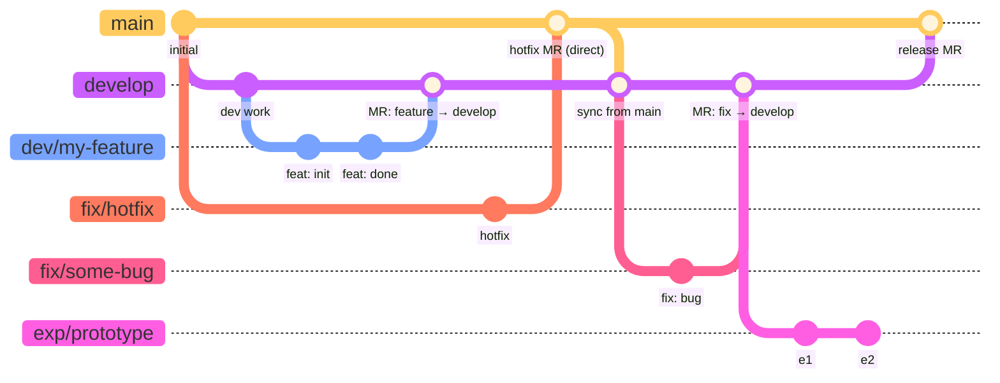

# Contributing

## TANGO Commandments
These are strict rules that all TANGO developers must follow.  These rules are
intended to prevent problems that TANGO users and developers have struggled
with.
1. <a id="rule-object-is-config"></a>**object == config**: All new code objects and attributes must comply with the object-is-config, config-is-object
  paradigm in which code objects and config (e.g. yaml files) have near 1:1
  congruence (exceptions could be e.g. parameter values that are derived upon
  instantiation).  Similarly, all new module structure must have reasonable
  compliance with this paradigm.
1. <a id="rule-locked-state"></a>**Mutation is guarded**: All state variables (i.e. any variables
  that mutate through temporal/time iterations) must be wrapped in
  `src/tango/core/locked_state.py::LockedState`, the single-value wrapper
  that enforces exactly one `update()` per time step, AND must live inside the
  component's `state` dataclass field — never as a bare `Component` attribute.
1. <a id="rule-state-history-parity"></a>**History is recordable**: All attributes in `*State` classes must have analogs in `*History`
  classes (a `list[T]` field, appended to in `record()`) — a value worth
  protecting as per-timestep state is worth keeping a time series of.
  Exception: `EconomicComponent`'s `EconomicState` has no `*History` class
  at all, since it isn't per-timestep state — the component runs exactly
  once (via `finalize()`), never through `record()`. Revisit if that
  changes.
1. <a id="rule-shared-by-reference"></a>**Single source of truth**: Any shared data that must be available within multiple objects in the
  hierarchy must be shared via reference rather than multiple, separate copies
  that can get out of sync.
1. <a id="rule-ci-checks"></a>**Deterministic quality checks**: All new code additions must pass:
    - `mypy` strict type checking (`strict = true` in `pyproject.toml`, with a
      small number of commented per-module relaxations there, e.g. for untyped
      third-party libraries)
    - `ruff` format checking
    - `pytest` tests

    All tests are automated through git hooks and GitLab pipelines and can optionally be run with `just check`.
1. <a id="rule-docstrings"></a>**Doc string formatting**: All doc strings must be formatted in Google style and explain what the
  documented object does, arguments, class attributes, outputs, ...
1. <a id="rule-pydantic-schemas"></a>**Schemas defined in code**: All class attributes representing simulation config or persisted/
  serialized state must be defined in pydantic schemas. Orchestration/wiring
  internals, runtime state governed by `LockedState` ([rule: LockedState](#rule-locked-state)), and framework
  primitives (e.g. `LockedState` itself) are exempt — they're never loaded
  from or dumped to config, so pydantic's validation/serialization contract
  doesn't apply to them.
1. <a id="rule-no-eval"></a>**See no `eval`**: There shall not be any `eval` functions!
1. <a id="rule-unit-conversion-factors"></a>**Unit conversions**: All unit conversion factors shall be defined in and imported from src/tango/core/constants.py
1. <a id="rule-finite-values-strenum"></a>**Enums for finite variants**: Any parameter that can take on a small, finite set of values should be
  handled as `StrEnum` so that we explicitly document and enforce these values.
1. <a id="rule-no-silent-pass"></a>**Guard against misused base classes**: Unimplemented base-class methods must `raise NotImplementedError` (or a
  more specific error), never a silent `pass`. A no-op placeholder is
  indistinguishable from "correctly does nothing" until someone goes
  looking, and can let real bugs run silently for a long time before
  anyone notices.
1. <a id="rule-unit-suffix-naming"></a>**Unit naming convention**: Any variable or YAML field whose value is in a non-SI unit must name that
  unit explicitly as a suffix (e.g. `p_out_megapascals`, not `p_out`) —
  converted to/from SI at the point the field is read, using the factors
  from [rule: unit conversion factors](#rule-unit-conversion-factors). Fields already in SI units (`T_out` in Kelvin, pressures in
  Pa, mass rates in kg/s, power in W, ...) need no suffix, since SI is the
  assumed default everywhere a name doesn't say otherwise. This avoids an
  implicit, file-global unit (e.g. TESPy's `Network(p_unit='bar', ...)`,
  so a bare `p_out: 0.05` would silently mean bar) in favor of one that's
  self-evident from the name alone, no matter where it's read out of
  context.
1. <a id="rule-descriptive-variable-names"></a>**No opaque short names for physical quantities**: Any variable, parameter, or field representing a
  physical quantity must use a full, descriptive name — never a bare
  single- or double-letter symbol (`rw`, `re`, `T`, `P`) copied straight
  out of a textbook formula. A short symbol lets two different physical
  quantities — or a radius substituted for a diameter — get silently
  swapped for each other, because the name itself carries no
  distinguishing information; a name like `wellbore_diameter_m` (vs.
  `wellbore_radius_m`) makes that kind of mismatch visually obvious at
  the call site in a way a bare `rw` cannot. This isn't a request for
  verbosity for its own sake — it's specifically about eliminating that
  class of bug.
1. **Document private attributes/fields**: All private attributes/fields and variables (e.g. preceded with `_` or `__`) must have an explanatory comment.
1. <a id="rule-encapsulated-mutation"></a>**Encapsulated mutation**: A class instance's fields must only be modified by the instance
  itself — via methods it defines, whether those methods are called
  internally or by external code — never by direct external assignment
  (`obj.field = value`). `state` (and `state`-shaped containers like
  `Stream`, whose own `LockedState` fields are directly `.update()`-able
  by external callers — see [rule: LockedState](#rule-locked-state)) is
  the one exception. **Not yet verified applied uniformly** — see
  `docs/tango_tasks.md`'s open-items list for the audit task.
1. <a id="rule-yaml-booleans"></a>**YAML booleans: `True`/`False`, never `yes`/`no`**: All boolean values in
  TANGO YAML files (`example_configs/`, `tests/`, any input config) must be
  written as `True`/`False` (Python-style capitalisation), never `yes`/`no`/
  `on`/`off`. Two reasons: a boolean field checked with `== "yes"` instead
  of a truthy test silently breaks when `True`/`False` is written instead —
  PyYAML parses `True` as a Python boolean, and `True == "yes"` is `False`;
  all boolean fields in `tango` must use proper boolean types, checked with
  `if value:`, never `if value == "yes":`. Separately, YAML 1.1 (PyYAML)
  treats `yes`/`no`/`on`/`off` as booleans while YAML 1.2 (ruamel.yaml and
  newer parsers) does not — those become plain strings, a silent mismatch
  if the parser is ever switched.
1. <a id="rule-example-configs-regression-covered"></a>**Every `example_configs/` YAML is regression-tested**: Every file in
  `example_configs/` must be covered by `just test --all` (`pytest`), not
  just `just apps`'s crash/no-crash smoke pass — a new example YAML is not
  done until it has real test coverage, whether that's a full-length run
  checked against a golden value or a smoke-level run checked for
  structural sanity. Exact depth (full run vs. reduced timestep count,
  golden-number vs. structural-only assertions) is a case-by-case call,
  not mandated here.

## Branching Strategy

### Persistent Branches
- `main` — production-ready code
- `develop` — integration branch for ongoing work

### Topic Branches
- `dev/<feature>` — feature branches (e.g., `dev/fix-convergence`)
- `fix/<issue>` — bug fixes
- `exp/<name>` — experimental / throwaway work

All merges into `main` must be peer reviewed via a GitLab Merge Request.
Topic branch work is normally merged into `develop` first; direct merges to
`main` require explicit sign-off from the TANGO lead developer (Chad Baker).
Case-specific work may be done directly on `develop` with lead-developer
approval.

### Branching Strategy Diagram

> **Note on diagram format**: Standard Markdown cannot embed draw.io (`.drawio`)
> files. The diagram below uses [Mermaid](https://mermaid.js.org/), which
> renders natively on GitLab, GitHub, and VS Code (with the Mermaid extension).



**Key rules encoded in the diagram:**

| Branch | Created from | Merges into | Requires MR? |
|---|---|---|---|
| `develop` | `main` | `main` | Yes |
| `dev/<feature>` | `develop` or `main` | `develop` or `main`* | Yes |
| `fix/<issue>` | `develop` or `main` | `develop` or `main`* | Yes |
| `exp/<name>` | anywhere | typically abandoned | — |

\* Direct merge to `main` requires lead-developer approval.

### Merge Requirements

**Tests must pass** before any Merge Request can be merged into `main` or `develop`.

All branches **must be up to date** with their target branch before they can be merged. This ensures that integration conflicts are resolved locally by the author.

#### Merging strategies
Depending on the target branch, use the following merge strategies:

- **Merging a topic branch (`dev/*`, `fix/*`) into `develop` or `main`**:
  - *Note: This must **always** be merged via a GitLab Merge Request.*
  1. Perform a **Squash merge**.
  2. Delete the source branch locally. CI automatically tags the branch tip to
     preserve history and automatically deletes the source branch on the server — see
     [Tagging deleted branches](#tagging-deleted-branches) for why this
     matters and the resulting `CHANGELOG.md` footer format.
- **Merging `develop` into `main`**:
  - *Note: This must **always** be merged via a GitLab Merge Request.*
  1. Perform a **Standard merge** (often called "Merge commit" or "Create a merge commit") to preserve the squashed history of the individual features.

To enforce these rules centrally, a project **Maintainer** should apply these settings once after creating the repository. They cannot be set by Developers and should not be automated by scripts or agents.

**Settings → General → Merge requests:**

| Setting | Value |
|---|---|
| Merge method | Merge commit |
| Squash commits | Encourage |
| ☑ Pipelines must succeed | checked |
| ☑ Delete source branch | checked |

**Settings → Repository → Protected branches** — add each branch:

| Branch | Allowed to merge | Allowed to push and force push |
|---|---|---|
| `main` | Maintainers | No one |
| `develop` | Maintainers | Developers + Maintainers |

## Setup

After cloning, install the git hooks using `just setup` (or run the `prek` command directly):
```bash
just setup
# or: uv run prek install --hook-type pre-commit --hook-type pre-push --overwrite
```

## Git Hooks

Git hooks are scripts that run automatically at key points in your Git workflow (e.g. before a commit or push). We use [`prek`](https://prek.j178.dev) to manage them, providing a consistent set of checks across all contributors. This enforces code quality and prevents accidental direct commits or pushes to `main` and `develop`. We split these checks to keep your development fast:
- **`pre-commit` (auto-format as you type):** Runs fast linting and formatting (Ruff).
- **`pre-push` (test before you share):** Runs heavier validation (Mypy type checking, Pytest) only when sharing code with the remote.

To skip a specific hook for one push, set the `SKIP` environment variable to the hook's `id` (not its display name):
```bash
SKIP=pytest git push
```
This skips the "Run test suite" hook while still running Mypy. Use sparingly — bypassing tests before sharing code is rarely a good idea.

## Changelog

[`CHANGELOG.md`](CHANGELOG.md) follows the [Keep a Changelog](https://keepachangelog.com/en/1.1.0/)
convention, using the standard KaC entry types:

| Category | When to use |
|---|---|
| `Added` | New user-visible functionality |
| `Changed` | Internal restructuring or behaviour change |
| `Deprecated` | Features that will be removed in a future version |
| `Removed` | Features removed in this version |
| `Fixed` | Defect corrections |
| `Security` | Security-related fixes |

Entries live under a `## [In Development]` heading at the top of the file
until a release is cut. Each `[In Development]` block may optionally note the
associated MR number in the **body** (not the heading) for traceability.

> **Public release note**: if/when this project is released publicly and adopts
> [Semantic Versioning](https://semver.org/), rename the `[In Development]`
> heading to `[Unreleased]` and update the footer link label to match. This
> aligns with the standard KaC convention and is expected by most changelog
> tooling (e.g. `git-cliff`, `standard-changelog`).

### When to add an entry

| Project phase | Merges into `develop` | Merges into `main` | Releases |
|---|---|---|---|
| **Pre-1.0** (current) | Optional | **Required** | **Required** |
| **Post-1.0** | Optional | Optional | **Required** |

**Pre-1.0 rationale**: Before the first release the changelog is the primary
record of what TANGO is becoming. Every merge into `main` represents a
meaningful, reviewable change that an end-user or future contributor will want
to understand, so an entry is expected.

**Post-1.0 rationale**: Once releases are the primary communication mechanism,
individual merges need not be documented — but every release *must* have a
complete entry so that upgrading users know exactly what changed.

### Format

The changelog is structured around **merge requests into `main`**, not releases.
Keep a `## [In Development]` stub at the very top for ongoing work. Right before a MR
is merged into `main`, convert it into a named section:

```markdown
## [In Development]

*(Nothing yet.)*

---

## MR !<N> — YYYY-MM-DD: <short title>

Optional summary paragraph.
[Link to MR !<N>](<gitlab MR URL>)

### Added
- **<Thing>** — description.

### Fixed
- **<Thing>** — description.
```

When the first public release is cut, group the relevant MR sections under a
`## [1.0.0] — YYYY-MM-DD` heading and update the [footer comparison
links](#tagging-deleted-branches) at the bottom of `CHANGELOG.md`.

### Tagging deleted branches

This matters because GitLab prunes branch refs when branches are deleted,
which would otherwise break `CHANGELOG.md` comparison links — see
[Merging strategies](#merging-strategies) for how the `bak/<branch-name>`
tag that prevents this gets created. The only tags you create by hand are
release tags (`v1.2.0`-style, see [Steps](#steps) below).

The `CHANGELOG.md` footer will then look like:

```markdown
[Unreleased]: https://gitlab.ethz.ch/geg/tango-projects/tango-core/-/compare/v1.2.0...HEAD
[1.2.0]: https://gitlab.ethz.ch/geg/tango-projects/tango-core/-/compare/v1.1.0...v1.2.0
[1.1.0]: https://gitlab.ethz.ch/geg/tango-projects/tango-core/-/releases/tag/v1.1.0
```

---

## Cutting an Internal (GEG-only) Release

TANGO is distributed internally to GEG group members as a private GitLab
dependency, pinned to a version tag — there is no PyPI package or GitLab
Package Registry publish step. "Cutting a release" means: bump the
version, tag it, push the tag. That tag is the release; consumers install
directly from it (see
[README.md#installation](./README.md#installation)).

### Versioning

TANGO follows [Semantic Versioning](https://semver.org/) (SemVer):
`version` in `pyproject.toml` is `MAJOR.MINOR.PATCH`, where `MAJOR` bumps
for a breaking change, `MINOR` for a backwards-compatible addition, and
`PATCH` for a fix-only release. See semver.org for the full spec.

Release tags are `v`-prefixed (`v1.0.0`, not bare `1.0.0`) to match the
convention already used to tell them apart from `bak/*` branch-preservation
tags (see [Tagging deleted branches](#tagging-deleted-branches)) — also the
more common convention for git tags generally (GitLab Releases and most
changelog/release tooling default to expecting a `v` prefix).

### Steps

1. Make sure `CHANGELOG.md`'s `## [In Development]` section reflects
   everything going into this release (see [Changelog](#changelog) above).
2. On `main`, bump `version` in `pyproject.toml` (e.g. `"1.0.0"` →
   `"1.0.1"`) and commit it (normal MR + review, same as any other change).
3. Once that commit is on `main`, tag it and push the tag:
   ```bash
   git checkout main && git pull
   git tag v1.0.1
   git push origin refs/tags/v1.0.1
   ```
   Do not reuse a version number for a different commit; cut a new
   patch/minor instead.
4. Nothing else publishes automatically — there is no CI release job. The
   pushed tag *is* the release; skip straight to telling consumers which
   tag to pin (or update whatever internal channel/doc tracks current
   recommended versions).
