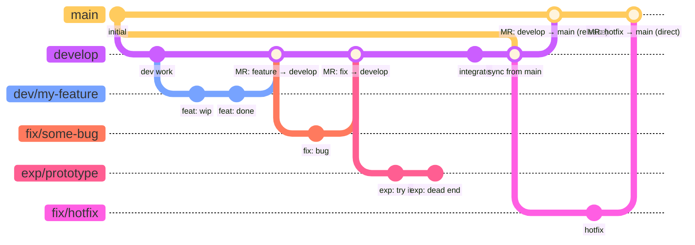

# Contributing

## Branch Naming Conventions

### Persistent Branches
- `main` — production-ready code
- `develop` — integration branch for ongoing work

### Topic Branches
- `dev/<feature>` — feature branches (e.g., `dev/fix-convergence`)
- `fix/<issue>` — bug fixes
- `exp/<name>` — experimental / throwaway work

All merges into `main` must be peer reviewed via a GitLab Merge Request.
Topic branch work is normally merged into `develop` first; direct merges to
`main` require explicit sign-off from the TANGO lead developer (Chad Baker).
Case-specific work may be done directly on `develop` with lead-developer
approval.

### Branching Strategy Diagram

> **Note on diagram format**: Standard Markdown cannot embed draw.io (`.drawio`)
> files. The diagram below uses [Mermaid](https://mermaid.js.org/), which
> renders natively on GitLab, GitHub, and VS Code (with the Mermaid extension).



**Key rules encoded in the diagram:**

| Branch | Created from | Merges into | Requires MR? |
|---|---|---|---|
| `develop` | `main` | `main` | Yes |
| `dev/<feature>` | `develop` or `main` | `develop` or `main`* | Yes |
| `fix/<issue>` | `develop` or `main` | `develop` or `main`* | Yes |
| `exp/<name>` | anywhere | typically abandoned | — |

\* Direct merge to `main` requires lead-developer approval.

## Setup

After cloning, enable the git hooks:
```bash
git config core.hooksPath .githooks
```

This enforces branch naming conventions and prevents accidental direct pushes to `main`.

## Changelog

[`CHANGELOG.md`](CHANGELOG.md) is inspired by [Keep a Changelog](https://keepachangelog.com/en/1.1.0/)
but uses project-specific sub-section names rather than the six standard KaC
types (`Added`, `Changed`, `Deprecated`, `Removed`, `Fixed`, `Security`).
The custom categories are preferred because they reflect how TANGO developers
actually think about changes — distinguishing a refactor from a bug fix, or
DevOps work from user-visible features, more clearly than the generic KaC
vocabulary:

| TANGO category | Closest KaC type | When to use |
|---|---|---|
| `✨ New Features` | `Added` | New user-visible functionality |
| `♻️ Refactoring` | `Changed` | Internal restructuring, no behaviour change |
| `🐛 Bug Fixes` | `Fixed` | Defect corrections |
| `🏗️ DevOps & Tooling` | `Changed` | CI, packaging, hooks, build system |
| `📚 Documentation & Examples` | `Changed` | Docs, examples, comments |

Entries live under an `## [Unreleased]` heading at the top of the file until a
release is cut. Each `[Unreleased]` block may optionally note the associated
MR number in the **body** (not the heading) for traceability.

### When to add an entry

| Project phase | Merges into `develop` | Merges into `main` | Releases |
|---|---|---|---|
| **Pre-1.0** (current) | Optional | **Required** | **Required** |
| **Post-1.0** | Optional | Optional | **Required** |

**Pre-1.0 rationale**: Before the first release the changelog is the primary
record of what TANGO is becoming. Every merge into `main` represents a
meaningful, reviewable change that an end-user or future contributor will want
to understand, so an entry is expected.

**Post-1.0 rationale**: Once releases are the primary communication mechanism,
individual merges need not be documented — but every release *must* have a
complete entry so that upgrading users know exactly what changed.

### Format

Add entries under the appropriate sub-section of `## [Unreleased]`:

```markdown
## [Unreleased] — MR !<N>: <short title>

### ✨ New Features
- **<Thing>** — description.

### 🐛 Bug Fixes
- **<Thing>** — description.
```

When cutting a release, rename `[Unreleased]` to `[x.y.z] — YYYY-MM-DD` and
open a fresh `## [Unreleased]` section above it. Update the [footer comparison
links](#tagging-deleted-branches) at the bottom of `CHANGELOG.md` at the same time.

### Tagging deleted branches

GitLab prunes branch refs when branches are deleted, which would break
`CHANGELOG.md` comparison links. To preserve a permanent pointer to where a
branch landed, **create a lightweight git tag immediately before deleting the
branch**:

```bash
git tag fix/some-bug          # lightweight tag, same name as branch
git push origin fix/some-bug  # push the tag
git push origin --delete fix/some-bug  # now safe to delete the branch
```

This is a well-established practice — tags are permanent and never move, so
the commit remains reachable even after the branch ref disappears.

> **Convention**: prefix *release* tags with `v` (e.g. `v1.2.0`) to
> distinguish them from branch-preservation tags (e.g. `fix/some-bug`).

The `CHANGELOG.md` footer will then look like:

```markdown
[Unreleased]: https://gitlab.ethz.ch/geg/tango-projects/tango-core/-/compare/v1.2.0...HEAD
[1.2.0]: https://gitlab.ethz.ch/geg/tango-projects/tango-core/-/compare/v1.1.0...v1.2.0
[1.1.0]: https://gitlab.ethz.ch/geg/tango-projects/tango-core/-/releases/tag/v1.1.0
```
