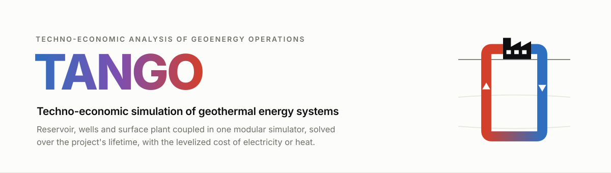
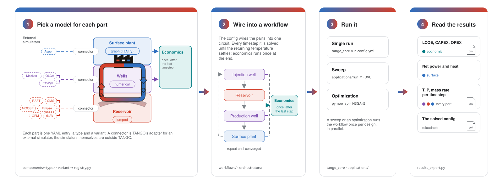

<picture>
  <source media="(prefers-color-scheme: dark)" srcset="docs/assets/banner-dark.svg">
  
</picture>

[](https://github.com/GEG-ETHZ/TANGO-core/actions/workflows/tests.yml)
[](https://github.com/GEG-ETHZ/TANGO-core/actions/workflows/docs.yml)
[](./NOTICE)
[](https://www.python.org/downloads/)
[](https://docs.astral.sh/uv/)
[](https://docs.astral.sh/ruff/)
[](https://mypy-lang.org/)
[](https://github.com/j178/prek)
[](https://github.com/gitleaks/gitleaks)
[](https://dvc.org/)
[](CHANGELOG.md)

**Techno-economic ANalysis of Geoenergy Operations. TANGO couples reservoir, wells, and surface plant in one modular simulator, solves them over the project's lifetime, and computes the levelized cost of electricity or heat.**


> [!NOTE]
> TANGO is research software of the Geothermal Energy and Geofluids group at ETH Zürich. It is confidential and licensed to GEG members only; see [`NOTICE`](NOTICE).

## Contents

1. [What TANGO models](#what-tango-models)
2. [How you use TANGO](#how-you-use-tango)
3. [How the code is organized](#how-the-code-is-organized)
4. [Start here](#start-here)
5. [Setup](#setup)
6. [Documentation and layout](#documentation-and-layout)
7. [Development and help](#development-and-help)
8. [License](#license)

## What TANGO models


## How you use TANGO



## How the code is organized


## Start here

To run TANGO, go to [Setup](#setup). To work on it, read the [package tour](src/tango/README.md) and [`CONTRIBUTING.md`](CONTRIBUTING.md). Working with an AI agent? Paste this into it:

```text
Read AGENTS.md in GEG-ETHZ/TANGO-core; it holds every instruction for agents in this repository.
```

## Setup

TANGO needs Python 3.11 (`>=3.11,<3.12`), [uv](https://docs.astral.sh/uv/getting-started/installation/) and read access to the private GitHub repository [`GEG-ETHZ/TANGO-core`](https://github.com/GEG-ETHZ/TANGO-core). [just](https://github.com/casey/just) and [direnv](https://direnv.net) are optional. The distribution is called `tango-core`; the import name is `tango`.

Add a pinned release to your own project:

```bash
uv add "git+ssh://git@github.com/GEG-ETHZ/TANGO-core.git" --tag v1.1.0
uv run tango_cli init .        # copies the templates into ./templates
```

Or clone the repository to work on it:

```bash
git clone git@github.com:GEG-ETHZ/TANGO-core.git tango-core
cd tango-core
just setup                     # installs dependencies and all git hooks
```

Then run the flagship example, a single-flash hydrothermal power plant, and save its results:

```bash
uv run tango_cli validate templates/hydro_sf_electric.yml
uv run tango_cli run templates/hydro_sf_electric.yml --save-dir results/
```

`results/` then holds the solved config, a per-timestep CSV and an economics CSV. The same from Python:

```python
from tango.workflows.workflow import Workflow

wf = Workflow.from_file("templates/hydro_sf_electric.yml")
wf.run()
```

The [installation guide](docs/guides/install.md) covers SSH access, release pinning and upgrades; [Run a simulation](docs/guides/run.md) describes each result file and the exit codes; optimizations live in [`applications/`](applications/README.md).

## Documentation and layout

The documentation is published as a private site for the GEG-ETHZ organization, built from [`docs/`](docs/); `just docs` previews it locally.

| Section | What it covers |
|---|---|
| [Getting started](docs/guides/install.md) | Installation, first run, templates, applications, Euler |
| [Architecture](docs/architecture/index.md) | Package layers, config to objects, the component circuit |
| [Runtime](docs/runtime/index.md) | The nested loops, boundary-condition iteration, one run end to end |
| [API reference](docs/reference/index.md) | Generated from the docstrings |
| [Contributing](CONTRIBUTING.md) | The TANGO commandments, workflow, tests, releases |

```text
src/tango/        the package: core, components, orchestrators, workflows, CLI, optimization
templates/        maintained configs, one or more per system type; back the tests and applications
applications/     optimizations and demos; each optimization is a DVC pipeline with a SLURM script
tests/            unit/ (fast, run in CI) and regtest/ (full simulations; the fast subset runs before push)
docs/             the documentation site: guides, architecture, runtime, deep dives, API reference
tools/            maintenance scripts, the diagram generators and git-hook helpers
```

## Development and help

```bash
just check          # format, lint, strict type check, fast tests
just docs           # documentation site on localhost
just diagrams       # regenerate the banner and the diagrams
```

Code changes follow the [TANGO commandments](CONTRIBUTING.md#tango-commandments); branching, pull requests and releases are in [`CONTRIBUTING.md`](CONTRIBUTING.md) and changes per release in [`CHANGELOG.md`](CHANGELOG.md).

| Need | Where |
|---|---|
| A question about using TANGO | Open an issue on [GitHub](https://github.com/GEG-ETHZ/TANGO-core/issues) |
| A bug | Open an issue with the config and the full traceback; see [Error tracebacks](docs/ERROR_TRACEBACKS.md) |
| A security problem | Follow [`SECURITY.md`](SECURITY.md); do not open a public issue |
| A publication | Cite TANGO with [`CITATION.cff`](CITATION.cff); GitHub shows a "Cite this repository" button for it |

## License

Copyright © ETH Zürich, Geothermal Energy and Geofluids (GEG) group, Department of Earth and Planetary Sciences. All rights reserved. TANGO is proprietary and confidential and licensed to current GEG members for internal use only. See [`LICENSE.txt`](LICENSE.txt) and [`NOTICE`](NOTICE).
