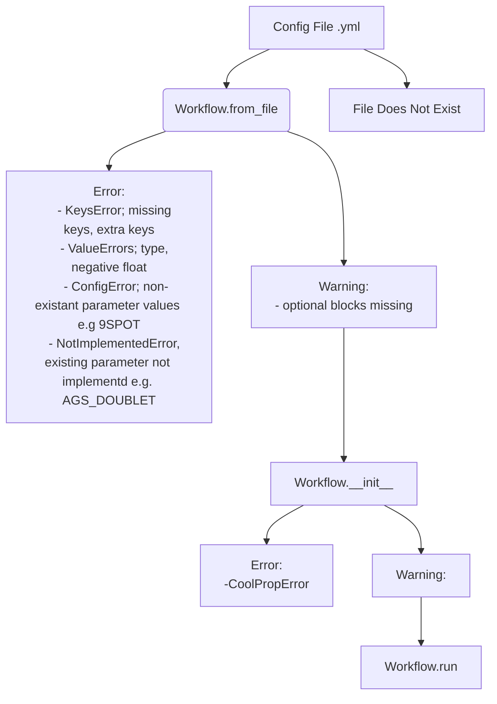

## Config Validation
This document is meant as a quick overview of how I have changed tango for configuration file validation.
The general idea of these changes is expressed in this diagram:

I think everything essential to running a Tango simulation should raise an error if it is not present or mis-enterred in the config file.

``src/tango/core/specs.py`` Handles most of the config errors. This is done using pydantic's ``@field_validator`` and ``@model_validator`` to raise ``ValueErrors`` or give warnings. For example a typical case is to raise a ``ValueError`` if a float is outside a physically plausible range, or just warn the user if the float seems very high. Consider the case of surface temperature: the plausible limits of temperature on earth are between around -70 and 60 degrees celsius, so outside of this range we raise a ValueError, but outside of the range -30 to 41 degrees celsius we just warn the user that their inputted surface temperature is very low/high. If you think these temperature ranges or error messages are a bit random we can choose something a bit more practical.

```python
class Common(BaseModel):
...
surface_temperature: float
...
    @field_validator("surface_temperature")
    @classmethod
    def check_surface_temperature(cls, v: float) -> float:
        """Checks the surface temperature is in plausible range if not raises ValueError
        Checks the surface temperature is in a resonable range if not logs warning"""

        if not (204 <= v <= 330):
            raise ValueError(
                f"""Surface temperature={v} K or {v - 273.5} degrees C this is outside of the current plausible range on earth of 184K to 330K (-89 to 60 degrees Celcius)
                    Please set the surface_temperature (K) to a value within this range in input YAML file"""
            )

        elif v > 315:
            logger.warning(
                f"""Surface temperature={v} K or {v - 273.15} degrees Celsius, this is quite high! Please double check your value"""
            )

        elif v < 223:
            logger.warning(
                f"""Surface temperature={v} K or {v - 273.15} degrees Celsius, this is quite low! Please double check your value"""
            )

        return v
```

When things become conditional in the case of ``injection_mode`` I have used pydantics ``model_validator(BaseModel)`` which takes a ``BaseModel`` class as an argument (in this case ``SimConfig``).  If ``injection_mode`` is set, then the user also needs to set a ``bc_checkpoint_index`` and if ``injection_mode`` is a manual type i.e. not ``AUTO_FLOW`` or ``AUTO_BOTH`` then the user must enter a ``mass_rate`` too. ``pydantic.model_validator()`` allows us to validate these logical requirements by treating the whole class, whereas ``pydantic.field_validator()`` only allows validating one field.
```python
class SimConfig(BaseModel):
    ...
    injection_mode: InjectionPolicy | None = None
    """Absent selects SystemDirect (no BC iteration); present selects
    SystemBCIteration."""
    mass_rate: float | None = None
    """Required unless injection_mode is absent, or is AUTO_FLOW/AUTO_BOTH
    (mass rate computed from fracing_flow() instead)."""
    bc_checkpoint_idx: int | None = None
    """Required when injection_mode is present."""
    ...
    @model_validator(mode="after")
    def check_injection_mode_requirements(self) -> SimConfig:
        if self.injection_mode is None:
            return self

        elif self.bc_checkpoint_idx is None:
            raise ValueError(
                f"""bc_checkpoint is required when injection mode is set
                got injection_mode={self.injection_mode}"""
            )

        auto_computed = {
            InjectionPolicy.AUTO_FLOW,
            InjectionPolicy.AUTO_BOTH,
        }  # NOTE: Update this if there are other ``auto`` modes created
        if self.injection_mode not in auto_computed and self.mass_rate is None:
            raise ValueError(
                f"""mass_rate is required when injection_mode={self.injection_mode}
                (only AUTO_FLOW/AUTO_BOTH compute the mass rate)"""
            )

        return self
```
Warning the user that there is no optional economic block is directly implemented in ``src/tango/workflows/workflow.py``. I changed this code from using ``self._economic_raw: dict[str, Any] = config.get("economic",{})`` to
```python
self._economic_raw: dict[str, Any]

try:
    self._economic_raw = config["economic"]
except KeyError:
    logger.warning("No economic component found, this simulation will run without economic outputs")
    self._economic_raw = {}
```
Which assumes the ``KeyError`` will be raised if the economic block does not exist or was somehow named incorrectly and not caught somewhere else, and then warns the user that there will be no economic component to the simulation.
This is presumably a temporary solution as like all other config blocks I assume there will be an ``Economic(BaseModel)`` where there will be more sophisticated validation.

I created tests for the error handling behaviour ``tests/regtest/test_config_errors/py``. These tests check that the right error type is raised from runnning ``Workflow.from_yaml()`` on a given incorrect config file. Note that all the errors in pydantic ``BaseModel``s get raised as a ``ValidationError`` which gets excepted in ``workflow.py`` and then raised as a ``ConfigError`` i.e. ``ConfigError`` is the only error type for a bad config file. The test script also tests that warning are raised for a missing optional block or a parameter outside a likely physical range.

## My questions/concerns:
1. Is storing the validation in the same ``.py`` file as each component class messy programming?
2. Is returning only ``ConfigError`` (rather than ``KeyError``, ``ValueError``) a bit ambiguous (although with a good message the user should know what to do)?
3. Is maintaining custom validations for each field component more effort than it is worth?
