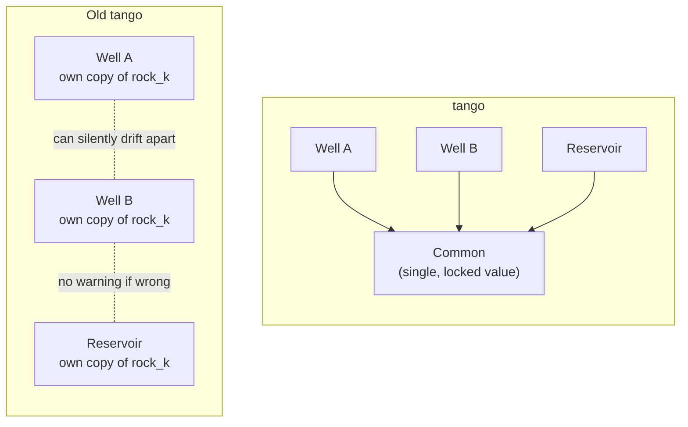
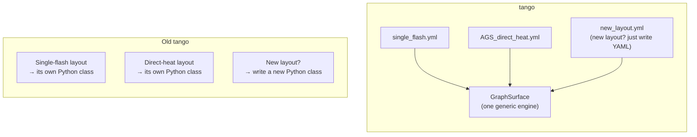
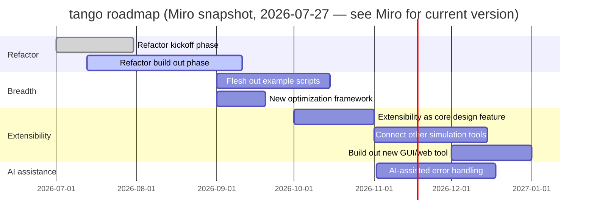

# tango: Progress Summary & Forward Plan

*Prepared 2026-07-24. Managerial-level summary — for engineering detail, see
`dev_docs/tango_tasks.md` (working task tracker) and
`dev_docs/TANGO_vision_and_roadmap/README.md` (full technical roadmap).*

## What this covers

`tango` is the in-progress rewrite of TANGO's simulation core. The old
implementation (`src/tango/`) remains the validated reference until the
rewrite is proven equivalent; both are maintained side by side during this
transition.

## Accomplished in the past 3 weeks

The throughline this period: `tango` isn't just a rewrite of what
already existed — it's structurally more usable, maintainable, and
extensible than the old codebase, and it is being built to modern software
engineering standards (e.g. `ruff` and `mypy` compliant) from day one rather
than retrofitting them later.

**Structural improvements that make the system easier to build on.**
Shared physical parameters (rock properties,
surface temperature/pressure) used to
be copied independently into every component that needed them — meaning
one component could silently drift out of sync with the rest of the system
with no warning. `tango` now enforces a single shared, locked source
of truth for these values at the data-model level: misconfiguration is
caught immediately at setup, not discovered later as a mysteriously wrong
result. Configuration is similarly locked against accidental modification
once a simulation is built, and computations now cascade cleanly down the
component hierarchy instead of being reassembled piecemeal — both closing
off entire categories of bugs by construction rather than by convention.

*Old tango: each component holds its own copy of a shared parameter — nothing stops
them from drifting apart. tango: every component reads the same locked value —
divergence is impossible by construction.*

**This isn't just theoretical — it already caught a real bug.** Applying
this state-management discipline surfaced a genuine, previously-unknown
inaccuracy in the *old* codebase: it exits its internal convergence loop
using a slightly stale intermediate value rather than the fully-converged
one, quietly under-stating energy extraction every timestep. `tango`'s
architecture makes this class of error structurally impossible — proof the
new design isn't just "cleaner," it's measurably more correct.

**Safety-critical operating logic is now self-documenting.** The old system
controlled a real safety concern — preventing "fracking" (unintentionally
fracturing the reservoir rock during fluid injection) — through three
separate, poorly-documented settings, and those three settings didn't map
cleanly onto the two physically distinct ways fracking can actually happen:
*wellhead-pressure-induced fracking* (the injection pump pushes wellhead
pressure high enough that, after accounting for the fluid column and
friction losses down the well, the pressure at the reservoir itself crosses
the fracking threshold) and *reservoir-back-pressure-induced fracking*
(pumping fluid in fast enough that the reservoir's own resistance to flow
pushes the pressure at the injection point past that same threshold, even
at a lower wellhead pressure). These are two different things that can each
independently cause the same failure, so a setup meant to guard against one
could leave the other unguarded without anyone noticing. `tango`
replaces all three old settings with a single,
explicitly-named, self-documenting mode setting (`InjectionPolicy`) that
makes exactly what protection is active — against which mechanism(s) —
obvious from the configuration itself, with room designed in for future
automated-safety modes. The basic mode is implemented and in use today;
the more advanced automated-protection modes are planned, tracked work,
not yet built.

**Developer onboarding is a first-class concern.** Legacy packaging/build
tooling and dead code were removed, license handling was consolidated, and
CI now runs a real, reliable test subset. A new contributor (or an intern
picking up this work, as confirmed by Dubhaltach McSweeney) has meaningfully
less accidental complexity to wade through before becoming productive.

**Modern development practices, applied consistently rather than bolted
on.** Every new `tango` module is fully type-checked (`mypy`) and
lint-clean (`ruff`) from its first commit, configuration is validated
through real schemas instead of untyped dictionaries, and every component
supports a clean save/load (serialization) contract — closing gaps the old
codebase never had answers for.

**Validated regression testing infrastructure.** Added "golden snapshot"
regression coverage and automated old-vs-new comparison tests, so that
future changes to `tango` are automatically checked against both a
known-good baseline and the legacy implementation. This is what lets
development continue at pace without re-litigating correctness by hand
every time.

**Surface plant layouts are now configuration, not code.** Previously, each
power-plant/surface layout (single-flash, direct-heat, etc.) required its
own hardcoded Python implementation — adding a new layout meant writing new
code. `tango` now reads the entire surface-plant topology (which
components exist, how they're connected) directly from the config file.
Supporting a new layout is a matter of describing it in config, not writing
and maintaining new code for it — a direct, concrete step toward the kind
of extensibility and composability described above.

*Old tango: every plant layout is its own hardcoded implementation. tango: one
generic engine reads any layout from config — new layouts need no new code.*

**AGS (closed-loop) system support.** Ported the AGS direct-heat use case
end-to-end into `tango`, including a working parameter-sweep example
demonstrating the new system can reproduce sweep-style analyses (varying a
design parameter across many runs) that were previously only possible in
the old codebase. This is the first fully modern, closed-loop system type
running in the new architecture.

**Documentation stays continuously synced with the code.** The technical
roadmap and its diagrams are kept in lockstep with what's actually built,
so the roadmap always reflects real state rather than stale planning.

## Where things stand

`tango` needs to cover every combination of geothermal system type and
product to fully replace the legacy system. Progress so far:

| | Heat extraction | Power extraction |
|---|:---:|:---:|
| AGS | ✅ | ⬜ |
| EGS | ⬜ | ⬜ |
| CPG | ⬜ | ⬜ |
| Hydrothermal | ⬜ | ✅ |

- `tango` can run: flexible single-flash plants (the original
  reference case) and AGS direct-heat systems, both validated against the
  old implementation.
- Still needed before AGS is "done": a power-generation counterpart (needs
  a new turbine/power-plant component that doesn't exist yet in
  `tango`), and a small number of edge-case validations.
- Economic modeling (cost/revenue calculations, LCOE/LCOH) has not yet been
  built into `tango` — this is a known, scoped gap, not an oversight.
- Optimization tooling (automated design-space search) is planned but not
  started.

## Plan for the next couple of months

*Snapshot of the [tango Miro board](https://miro.com/app/board/uXjVOfwfxsY=/?moveToWidget=3458764679176539081&cot=14)'s
Gantt chart as of 2026-07-27, for quick reference only. **The Miro board is the
maintained, authoritative version of this timeline** — this diagram is a
point-in-time copy and will not be kept in sync automatically; treat it as
stale the moment the Miro board changes.*

1. **Finish AGS parity** — build the missing power-generation component,
   port the electric-generation sweep, and validate both heat and power
   variants against the old codebase.
2. **Broaden system coverage** — fill out the remaining combinations of
   geothermal system type (EGS, CPG, conventional hydrothermal) crossed
   with heat vs. power output, so `tango` covers the same range of
   use cases as the legacy system.
3. **Port the wider example library** — roughly 68 previously-validated
   configurations from the old system are queued to be confirmed running
   correctly in `tango`.
4. **Design the economics layer** — LCOE/LCOH cost modeling for `tango`,
   currently a placeholder.
5. **Build an optimization API** — automated design-space search
   (multi-objective optimization) for `tango`, modeled on a proven
   pattern from a sister project, with an explicit design principle that
   the tool will surface tradeoffs to the user rather than silently
   picking a "best" answer on their behalf.
6. **Performance profiling** — once feature coverage stabilizes, profile
   `tango` properly and address any real hotspots (deferred
   deliberately — correctness and clarity were prioritized over speed
   during initial development).
7. **Retire the old codebase** — once all configurations are validated
   against `tango`, begin removing `src/tango/` and reducing the
   system to a single, modern implementation.

## Bottom line

The past three weeks focused on making the new codebase trustworthy — closing
the specific kinds of silent-failure bugs that made the old system hard to
maintain — and proving that trust with automated regression coverage, not
just on paper. The next phase shifts from foundation-building to breadth:
covering more system types, more examples, and the economic/optimization
features needed for `tango` to fully replace the legacy implementation.
