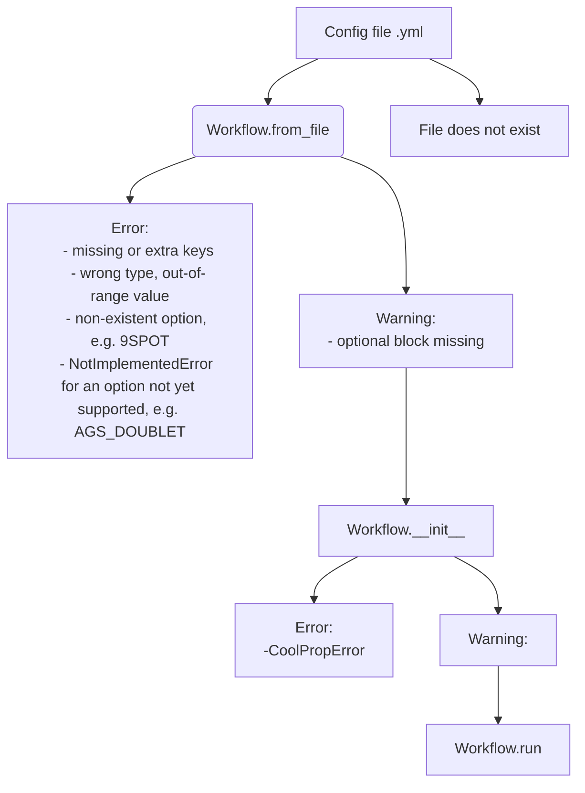

# Config Validation

How TANGO validates a configuration file before any simulation runs: which
errors are raised for missing keys, wrong types and unsupported values, and
where each check lives. Status: available; open questions are listed at the end.

## Principle

Every setting a simulation needs must raise an error if it is missing or
mis-entered in the config file. Settings that are optional, or valid but
unusual, produce a warning instead. Validation finishes before the first
timestep, so a bad config never fails halfway through a run.



## Where the checks live

Most checks are pydantic validators in `src/tango_core/core/specs.py`.
`@field_validator` checks one field; `@model_validator` checks rules that
span several fields. A validator raises `ValueError` for a value that cannot
be right and logs a warning for a value that is plausible but unusual.

Every pydantic `ValidationError` is caught in `Workflow.__init__`
(`src/tango_core/workflows/workflow.py`) and re-raised as `ConfigError`, so
`ConfigError` is the single error type for a bad config file. `tango_core`
maps it to exit code 1.

### Example: a single field

`surface_temperature` is in kelvin.

| Range | Result |
|---|---|
| Outside 204–330 K (−69.15 to 56.85 °C) | `ValueError`; almost certainly a unit mistake (°C entered as K) or a typo |
| Above 315 K (41.85 °C) or below 278 K (4.85 °C) | Warning; plausible but unusual for a geothermal site |
| Otherwise | Accepted |

```python
class Common(BaseModel):
    ...
    surface_temperature: float
    ...
    @field_validator("surface_temperature")
    @classmethod
    def check_surface_temperature(cls, te: float) -> float:
        if not (204 <= te <= 330):
            raise ValueError(...)  # outside the plausible range
        elif te > 315:
            logger.warning(...)  # quite high
        elif te < 278:
            logger.warning(...)  # quite low
        return te
```

### Example: rules across fields

`SimConfig.check_injection_mode_requirements` is a `@model_validator`,
because `injection_mode` decides which other fields are required:

| `injection_mode` | `bc_checkpoint_idx` | `mass_rate` |
|---|---|---|
| absent (`SystemDirect`) | not used | as given |
| `manual`, `manual-fracking-check` | required | required |

```python
class SimConfig(BaseModel):
    ...
    injection_mode: InjectionPolicy | None = None
    mass_rate: float | None = None
    bc_checkpoint_idx: int | None = None
    ...
    @model_validator(mode="after")
    def check_injection_mode_requirements(self) -> SimConfig:
        if self.injection_mode is None:
            return self
        if self.bc_checkpoint_idx is None:
            raise ValueError(...)
        if self.mass_rate is None:
            raise ValueError(...)
        return self
```

### Example: an optional block

The `economic` block is optional. `Workflow.__init__` builds it with
`_build_economic_component` and, if the block is absent, logs a warning and
runs without economic outputs:

```python
try:
    self._economic = _build_economic_component(config["economic"])
except KeyError:
    logger.warning("No economic component found, this simulation will run without economic outputs")
    self._economic = None
```

## Tests

`tests/regtest/test_config_validation.py` loads deliberately broken configs
with `Workflow.from_file()` and checks that each raises the expected error:
`ConfigError` for a missing block or a wrong value, `NotImplementedError`
for an option that is recognized but not implemented. It also checks that
a missing optional block or an unusual value logs a warning while the
`Workflow` is still built. Problems that only appear once `Workflow.run()`
starts are out of scope for that file.

## Open questions

1. Validators live in the same module as the schema they validate. Whether
   larger components should move their validators into separate modules is
   undecided.
2. Every config problem surfaces as `ConfigError` rather than `KeyError` or
   `ValueError`. The message names the field, but callers cannot branch on
   the kind of problem.
3. Each custom field validator is code to maintain. Where a pydantic
   constraint (`gt=0`, `Literal[...]`) expresses the same rule, it is the
   cheaper option.
