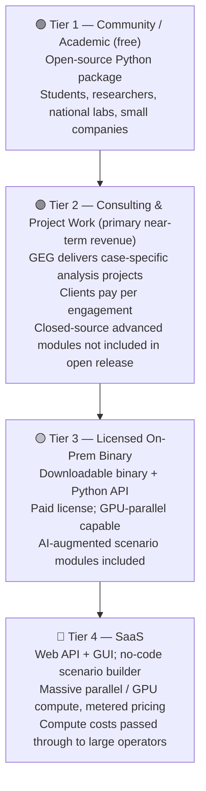
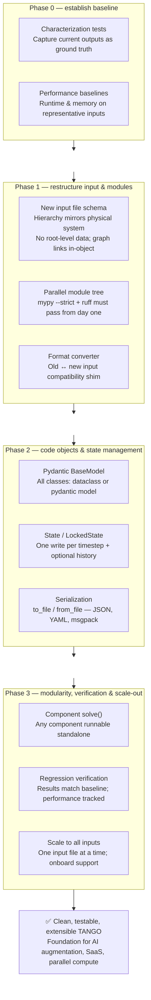

# TANGO: Vision & Development Roadmap

## What is TANGO?

TANGO is GEG's geothermal simulation platform. This document describes where TANGO is
heading — both as a product that generates revenue for GEG, and as a software system that
can support that goal reliably.

---

## Product Vision: Four-Tier Access Model

The core idea is to serve a wide range of users — from students and researchers to major
oil and gas operators — through a tiered access model. Each tier unlocks more capability
and generates more revenue for GEG. The consulting/project tier is the **primary near-term
revenue path** and should be treated as such until TANGO's capabilities are robustly
demonstrated.

### Tier 1 — Community / Academic (free or very low cost)

**Who:** Students, universities, national labs, researchers, small companies (e.g. Ad Terra Energy)

**What:**
- Open-source Python package (PyPI, public GitHub/GitLab)
- Hosted documentation and worked examples
- Community contribution pipeline — bug reports, feature requests, pull requests

**Why:** Builds the user base, the TANGO brand, and the feedback loop that drives improvement.
Open-source contributions expand TANGO's capabilities at no direct cost to GEG.

---

### Tier 2 — GEG Consulting Projects (primary near-term revenue)

**Who:** Any client who wants TANGO-based analysis delivered by GEG experts

**What:**
- GEG runs TANGO on behalf of the client, delivers results and interpretation
- Closed-source advanced modules (proprietary physics, AI capabilities) not released
- Client pays per project; this is the primary mechanism for TANGO funding and feedback early on

**Why:** This is the defensible path before TANGO is proven at scale. Clients pay for
expertise and results, not just software. Project work generates both revenue *and* direct
feedback on what TANGO needs to do better.

---

### Tier 3 — Licensed On-Prem Binary

**Who:** Medium and large operators who want to run TANGO on their own infrastructure

**What:**
- Downloadable binary with a Python API
- Paid license (annual or perpetual)
- GPU-parallel compute capability
- AI-augmented scenario generation and uncertainty quantification modules

**Why:** Larger operators have IT/security reasons to prefer on-prem deployments. A
licensed binary protects GEG's IP while giving clients flexibility.

---

### Tier 4 — SaaS (Cloud, Web API & GUI)

**Who:** Large utilities, oil & gas majors, operators who want to run thousands of simulations

**What:**
- Web-based Python API (programmatic access, batch runs)
- Web GUI (no-code scenario builder for non-programmers)
- Massive parallelism with GPU acceleration — compute costs metered and passed through
- Full AI capabilities (surrogate models, Bayesian optimization, uncertainty quantification)

**Why:** The highest-value offering. Large operators need to run scenario sweeps at a scale
that is impractical on-prem. Compute costs are paid by the client — GEG's margin is on
the platform and the IP, not the hardware.

---

### Licensing Strategy Notes

The open/closed boundary is a key decision. One reasonable approach:

| Component | Open-source? | Notes |
|---|---|---|
| Core simulation engine | Yes (eventually) | Harness community contributions |
| Standard input/output utilities | Yes | Drives adoption |
| AI/ML augmentation modules | No | Primary commercial differentiator |
| GPU / massive-parallel backend | No | Tier 3/4 only |
| Advanced analysis workflows | No | Delivered via consulting (Tier 2) |

This mirrors models used successfully by e.g. OpenFOAM (open core) + commercial
extensions, or Ansys (open APIs, proprietary solver backends).

---

## Technical Roadmap: The TANGO Refactor

### Why TANGO Needs a Refactor

The current TANGO codebase is a product of rapid, results-driven development. It works,
but it has accumulated structural debt that will limit everything in the product vision above:

- No reliable way to test individual components in isolation
- Input file format does not match the module structure or the physical system hierarchy
- State management is implicit — hard to reason about, impossible to parallelize safely
- No serialization contract — saving and loading intermediate states is fragile
- No type safety — mypy fails, runtime errors are hard to trace

The refactor does not aim to rewrite TANGO from scratch. It aims to **make TANGO congruent**
— so that the input format, the code objects, the module layout, and the physical systems
they represent all tell the same story.

---

### Refactor Phases

---

### Phase 0 — Establish Baseline (before touching any code)

**Goal:** Lock down what TANGO currently does so that refactored code can be verified against it.

- Write **characterization tests** that run current TANGO on a set of representative input
  files and save the outputs as reference fixtures
- Capture **performance baselines** (runtime, memory consumption) on those same inputs
- These baselines are the regression test suite — any future change that breaks them is
  immediately visible

---

### Phase 1 — Restructure Input Format & Module Layout

**Goal:** Make the input files, the module structure, and the physical system hierarchy
all congruent with each other.

- **New input file schema:** Each component (e.g. `injection_wellbore`) stores all its own
  attributes, its graph link index, and its previous/next link IDs. No data at root level.
  Hierarchy of data approximately matches hierarchy of physical systems.
- **Parallel module tree:** New code structure built alongside (not replacing) the old one
  until verified. `mypy --strict` and `ruff` pass from the first commit.
- **Format converter:** Bidirectional tool to convert between old and new input format,
  preserving compatibility while migration is in progress.

---

### Phase 2 — Code Objects & State Management

**Goal:** All TANGO code objects have explicit, validated structure and a clean state contract.

- **Pydantic `BaseModel` (preferred) or `dataclass`** for all classes — structure is visible
  from the code itself, not inferred from runtime behavior.
- **`state` object per component** — transient state variables stored in a component-specific
  `state` instance, not scattered across the object.
- **`LockedState`** — enforces that each state variable can be updated once and only once per
  timestep. Catches a whole class of subtle simulation bugs.
- **`history` object** — saves state at user-specified intervals; supports `None` (no temporal
  output) for performance-critical runs.
- **Serialization:** Every TANGO code object gets `to_file` / `from_file` / `to_str` /
  `from_str` methods. Format-agnostic (JSON, YAML, MessagePack, pickle).

---

### Phase 3 — Modularity, Verification & Scale-Out

**Goal:** TANGO components are independently testable; the full system is verified against
baseline; the refactor is applied to all input configurations.

- **`solve()` method per component:** Any physical component can be instantiated and solved
  independently via a test harness, without requiring the full TANGO system to be running.
  This is the foundation for unit testing, debugging, and eventually parallelization.
- **Regression verification:** Run the refactored system on all baseline input files;
  verify results match within tolerance; flag divergences for investigation in both
  old and new code.
- **Scale-out:** Work through all TANGO input file configurations one at a time. Onboard
  Janna or additional support to accelerate this phase.

---

## The Connection: Refactor Enables the Product Vision

The refactor is not an end in itself. It is the prerequisite for everything in the product
vision above:

| Product goal | Requires from refactor |
|---|---|
| Reliable consulting deliverables | Characterization tests, regression suite |
| Licensed binary distribution | Serialization, clean module boundaries |
| GPU / massive parallel compute | `LockedState`, component-level `solve()` |
| AI augmentation (surrogate models) | Clean state interface, history objects |
| SaaS web API | Serialization, input validation (pydantic) |
| Community contributions | Type safety (mypy), readable module structure |

---

## Summary

1. **Near term:** Establish baseline tests, begin Phase 1 refactor on one representative
   input file, start taking consulting projects to validate TANGO's value and fund development.
2. **Medium term:** Complete Phases 2 and 3; TANGO is clean, testable, and extensible.
   Begin building the binary distribution and licensing infrastructure.
3. **Long term:** SaaS offering with AI augmentation for large operators; community open-source
   release to drive adoption and contributions.

The licensing model and the refactor roadmap are not separate decisions — they should be
developed together, because the architecture of the code determines what business models
are even feasible.
