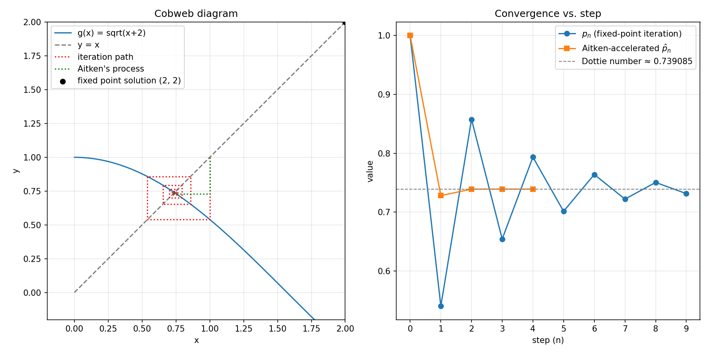
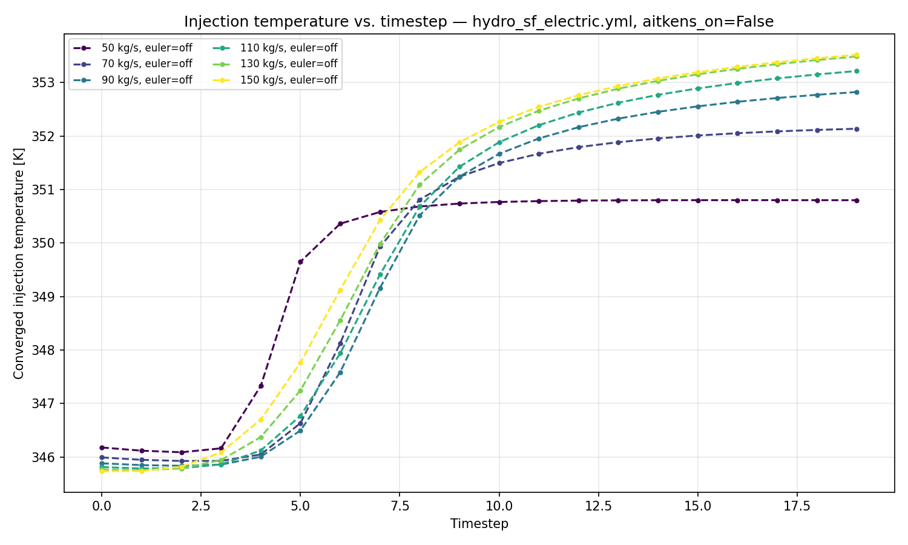

# Aitken Speed-Up

How Aitken relaxation (`core/accelerators.py::aitken_relax`) accelerates the
injection-temperature loop in `SystemBCIteration`, the method behind it, and
the measured speed-up against plain fixed-point iteration. Status: available.

## Background

### Fixed-point iteration

A fixed-point problem asks for $x$ with $f(x) = x$. The simplest numerical
method starts from a guess $x_0$ and feeds each result back in:

$$x_n = f(x_{n-1})$$

This is Picard (fixed-point) iteration. If it converges, eventually
$f(x_n) \approx x_n$ within a tolerance. For example, $x_{n+1} = \cos(x_n)$
converges from any starting angle in radians to the Dottie number,
$0.739085133\ldots$

### Aitken's method

Aitken's $\Delta^2$ process uses the last three iterates to extrapolate
toward the limit. With $\Delta x_n = x_n - x_{n-1}$:

$$\hat{x}_n = x_n - \frac{(\Delta x_n)^2}{\Delta x_n - \Delta x_{n-1}}$$

The correction acts like a damping or acceleration term. When the iterates
move steadily in one direction, the extrapolation takes larger steps. When
they overshoot back and forth, it damps the steps.



### The fixed-point problem in TANGO

The injection temperature is a fixed-point problem. From an injection
temperature $T_n$, the fluid travels down the injection well(s), through
the reservoir, up the production well(s) and through the surface plant. It
returns at $T_{n+1} = G(T_n)$. The loop has converged when
$|T_{n+1} - T_n| < 0.5\,\mathrm{K}$. The problem is solved every timestep,
starting from the previous timestep's solution. Before the accelerator was
added, TANGO used plain Picard iteration, $T_{n+1} = G(T_n)$.

## Implementation

`aitken_relax` in `src/tango/core/accelerators.py` implements the
Irons–Tuck form of Aitken relaxation. `SystemBCIteration._converge_injection_T`
calls it after every pass of the circuit to choose the next injection
temperature.

With the residual $r_n = \tilde{x}_n - x_{n-1}$, where $\tilde{x}_n$ is the
raw new value $G(x_{n-1})$, the update is

$$x_n = x_{n-1} + \delta_n r_n, \qquad
\delta_n = -\delta_{n-1}\,\frac{r_{n-1}\,(r_n - r_{n-1})}{(r_n - r_{n-1})^2}$$

Conditions on the update:

1. **First step.** With no history, $\delta = 1$ (`init_relax`), which is a
   plain Picard step.
2. **Pole guard.** If $r_n = r_{n-1}$, the previous $\delta$ is reused
   instead of dividing by zero.
3. **Clipping.** $|\delta|$ is clipped to $[0.001, 1000]$ (`min_relax`,
   `max_relax`), keeping its sign.
4. **First timestep.** Before the first pass of the first timestep the
   injection temperature is `nan`, and `aitken_relax` is bypassed by the
   check `T_inj_prev > 0`. Every comparison with `nan` is false, and any
   real temperature in kelvin is positive. Relaxation therefore starts from
   the third pass on the first timestep and from the second pass on later
   timesteps.

```python
    r_new = x_tilde - x_prev

    if iteration == 0 or delta_prev is None or r_prev is None:
        delta = init_relax
        x_new = (1 - delta) * x_prev + delta * x_tilde
        return x_new, r_new, delta

    diff = r_new - r_prev
    if diff == 0:
        delta = delta_prev  # avoid the pole
    else:
        delta = -delta_prev * (r_prev * diff) / (diff * diff)
        sign = 1.0 if delta >= 0 else -1.0
        delta = sign * min(max(abs(delta), min_relax), max_relax)

    x_new = x_prev + delta * r_new

    return x_new, r_new, delta
```

## Evaluated alternative: extrapolating between timesteps

A simple first guess for a new timestep was evaluated and then removed from
the code. Instead of reusing the previous timestep's solution, it
extrapolates linearly from the two previous timesteps:

$$T_{t+1} = T_{t} + (T_{t} - T_{t-1})$$

```python
if self.euler_on and (self.Tm2 is not None) and (self.Tm2 is not None):
    inj_well.inlet.T = (self.Tm1 + (self.Tm1 - self.Tm2))
```

The guess was set before the convergence loop started. After the loop,
$T_{t-1}$ moved to $T_{t-2}$ and the new result was stored as $T_{t-1}$:

```python
self.Tm2 = self.Tm1
self.Tm1 = T_tilde
```

## Results

### Extrapolated first guess

A prototype with the extrapolation as a toggle was swept across mass rates
for single-flash and double-flash configurations:

| Mass Rate | Iterations Without Extrapolation | Iterations With Extrapolation | Decrease in Iterations (%) |
|-----------|---------------------------|-------------------------|------------------------------|
| 50 | 14 | 16 | -14.29 |
| 70 | 23 | 21 | 8.70 |
| 90 | 25 | 23 | 8.00 |
| 110 | 25 | 24 | 4.00 |
| 130 | 25 | 23 | 8.00 |
| 150 | 26 | 22 | 15.38 |

The extrapolation helps at high mass rates. The temperature histories
explain why:



A high mass rate smooths the transition from low to high temperature, which
a linear extrapolation follows well.

### Aitken relaxation

With the default tolerance `_DT_SURFACE_TOL = 0.5` K, a standard run is as
fast with Aitken relaxation as without it. The comparison was made by
profiling the same config with and without the accelerator
(`uv run tools/run_tango_profile.py --profile`). The accelerator is now
always on, so the comparison cannot be repeated without changing the
code.

## Design notes

1. **Aitken relaxation is always on.** There is no switch, which keeps the
   loop simple. The accelerator adds no measurable cost at the default
   tolerance.
2. **The extrapolated first guess was removed.** It helps only when the
   temperature history is smooth, for example at high mass rates. Whether a
   run benefits is not known until it has run. The implementation is small
   and can be restored if a class of simulations benefits.
3. **Tolerances.** Lowering the temperature tolerance from 0.5 K to
   $10^{-6}$ K changes the production-well temperature and the net power
   negligibly for single-flash and double-flash plants. In the auto
   injection modes, a lower temperature tolerance helps the outer
   pressure or flow-rate loop converge. As a rule of thumb, the temperature
   tolerance in kelvin should be no more than about 500 times the relative
   pressure or flow-rate tolerance. The pressure and flow-rate tolerance is
   now $10^{-3}$ (`DEFAULT_TOLERANCE`), which matches 0.5 K.

## Open questions

1. Is 0.5 K the right injection-temperature tolerance for every system
   type, or should it scale with the outer-loop tolerance?
