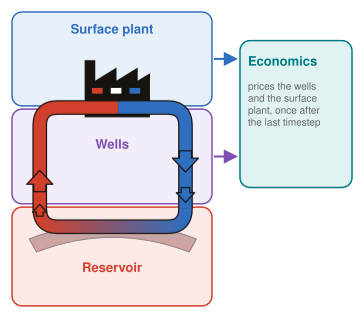
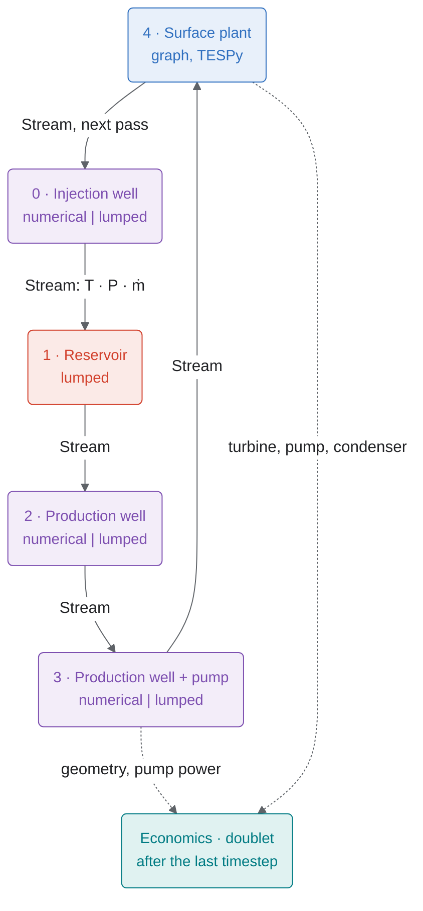

# The component circuit

{ align=right width="260" }

A TANGO system is a closed loop of components. Each component's `solve(inlet)` turns an inlet `Stream` (temperature, pressure, mass rate, each held in a `LockedState`) into an outlet `Stream`, which the orchestrator passes to the component named by `next`. Components are solved in `component_idx` order; the loop is cut at the injection well, so the surface plant's outlet feeds the injection well on the next pass. Economics (`components/economic`) is not part of the loop: it runs once after the last timestep and prices the wells (geometry, pump power) and the surface plant (turbine, pump, condenser). It does not price the reservoir and never feeds back into the physics.

The circuit above is `templates/hydro_sf_electric.yml`. The four system types reuse the same building blocks:

| System | Example config | Fluid | What differs |
|---|---|---|---|
| Hydrothermal | `hydro_sf_electric.yml`, `hydro_df_electric.yml`, `hydro_orc_electric.yml` | H₂O | Flash or ORC surface graph |
| EGS | `EGS_electric.yml`, `EGS_direct_heat.yml` | H₂O | Stimulated (high-permeability) reservoir, pumped production well |
| CPG | `CPG_electric.yml` | CO₂ | sCO₂ turbine and condenser, no pump |
| AGS | `AGS_direct_heat.yml` | H₂O | Closed loop with no reservoir: injection well → `horizontal_well` → production well → surface |

Electricity versus direct heat is set by `economic.main_product` and the surface graph.

| `type` | `variant` | Class |
|---|---|---|
| `injection_well` | `lumped`, `numerical` | `LumpedInjectionWell`, `NumericalInjectionWell` |
| `production_well` | `lumped`, `numerical` | `LumpedProductionWell`, `NumericalProductionWell` |
| `production_well_with_pump` | `lumped`, `numerical` | `LumpedProductionWellWithPump`, `NumericalProductionWellWithPump` |
| `horizontal_well` | `numerical` | `NumericalWell` |
| `reservoir` | `lumped` | `LumpedReservoir` |
| `surface` | `graph` | `GraphSurface` |
| `economic` | `doublet` | `DoubletEconomicComponent` |

To add a component, see `src/tango/components/AGENTS.md`.
