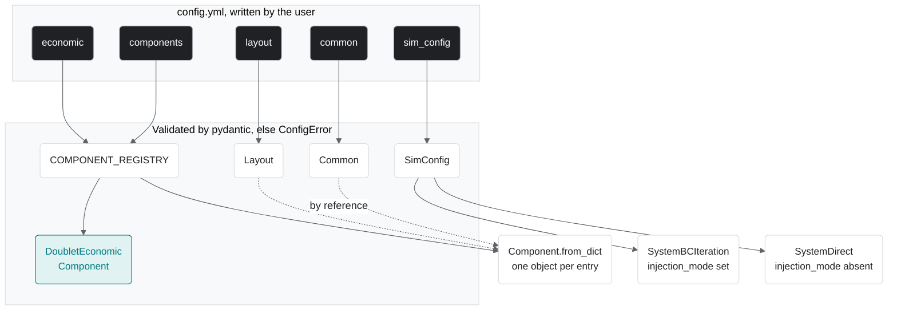

# From config to objects

TANGO follows *object == config* (the first commandment in `CONTRIBUTING.md`): every block in the YAML file becomes one validated object. `Workflow.__init__` (`src/tango/workflows/workflow.py`) does the mapping; a validation failure raises `ConfigError` before anything runs.

| YAML block | Becomes | Defined in |
|---|---|---|
| `common` | `Common`, one instance shared by reference with every component | `src/tango/core/specs.py` |
| `layout` | `Layout`; `well_spacing` and `well_pattern` are copied into components that declare them | `src/tango/core/specs.py` |
| `sim_config` | `SimConfig`: `num_tsteps`, `dt_years`, `injection_mode`, `mass_rate`, `max_mass_rate`, `target_extraction_pressure`, `bc_checkpoint_idx` | `src/tango/core/specs.py` |
| `components.<name>` | `COMPONENT_REGISTRY[(type, variant)].from_dict(...)` | `src/tango/components/registry.py` |
| `economic` | `COMPONENT_REGISTRY[("economic", type)]`, today `DoubletEconomicComponent` | `src/tango/components/registry.py`, `src/tango/components/economic/doublet.py` |
| `title`, `description` | `Description` (optional) | `src/tango/core/specs.py` |

The orchestrator follows from one key: if `sim_config.injection_mode` is set, the run uses `SystemBCIteration`; if it is absent, `SystemDirect` (one pass per timestep). Every config in `example_configs/` sets it.

A component block may not set `common` or the layout-derived keys itself; the workflow threads those in from the single source above. See [config validation](../CONFIG_VALIDATION.md) for the full set of checks.
