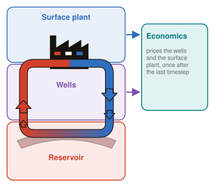
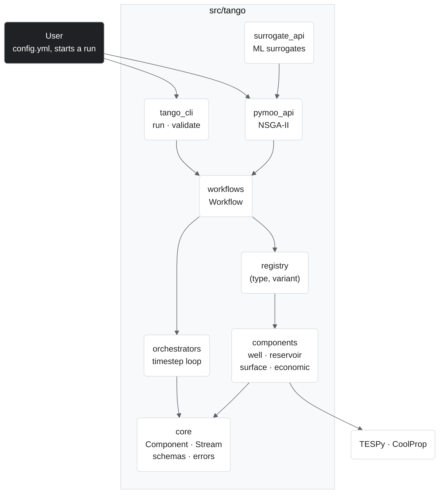

# Architecture

{ align=right width="260" }

TANGO is one Python package, `src/tango/`, built in layers. A user writes a YAML config and starts a run; everything below that line is validated code. Each layer imports only the layers beneath it, with one exception: `core/specs.py` uses the well-pattern helper from `components/reservoir/`. The third-party engines run in-process: TESPy is called from `components/surface/`, CoolProp from `core/` (fluid properties).

## Where is what

| Layer | Path | Holds |
|---|---|---|
| Entry points | `src/tango/tango_cli.py` | `tango_cli run`, `validate`, `init` |
| | `src/tango/pymoo_api.py` | NSGA-II optimization over full runs |
| | `src/tango/surrogate_api.py` | ML surrogate sampling, training and search |
| | `src/tango/results_export.py` | `write_results`: YAML plus CSV files |
| Workflow | `src/tango/workflows/` | `Workflow`: config in, orchestrator out |
| Orchestration | `src/tango/orchestrators/` | `SystemDirect`, `SystemBCIteration` |
| Components | `src/tango/components/` | wells, reservoir, surface plant, economics, `COMPONENT_REGISTRY` |
| Core | `src/tango/core/` | `Component`, `Stream`, `LockedState`, specs, policies, errors, numerics |

Around the package:

| Path | Role |
|---|---|
| `example_configs/` | The maintained configs; each backs a test or an application |
| `applications/` | Multi-run pipelines (sweeps, optimizations) built on those configs |
| `tests/` | `unit/` and `regtest/` |

Next: [how a config becomes objects](config.md) and [what flows between components](components.md). For how a run iterates, see [Runtime](../runtime/index.md).
