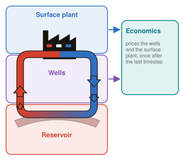

# Components

A TANGO system is built from four component types. Each is one entry under
`components:` (or the `economic:` block) in the config, chosen by its
`type` and `variant`, and each has one color used in every diagram.

| Component | Config `type` | Variants | Code |
|---|---|---|---|
| well [Wells](wells.md) | `injection_well`, `production_well`, `production_well_with_pump`, `horizontal_well` | `lumped`, `numerical` (`horizontal_well`: `numerical` only) | `components/well/` |
| reservoir [Reservoir](reservoir.md) | `reservoir` | `lumped` | `components/reservoir/` |
| surface [Surface plant](surface-plant.md) | `surface` | `graph` (TESPy) | `components/surface/` |
| economic [Economics](economics.md) | `economic: type: doublet` | `doublet` | `components/economic/` |

{ width="320" }

The wells, reservoir and surface plant are solved in a loop every timestep,
passing temperature, pressure and mass flow to each other
([Component circuit](../architecture/components.md)). Economics runs once
after the last timestep and prices the wells and the surface plant.

Each component page has the same parts: what the component models, the
model as documented in the code, its config keys, and the per-timestep
values it writes to `<name>.smry.csv`. The key and output tables are
generated from the code by `tools/gen_reference.py`; entries marked
*draft* or *undocumented* are docstrings still to be reviewed or written.
All keys in one place: [Config reference](../reference/config.md).
