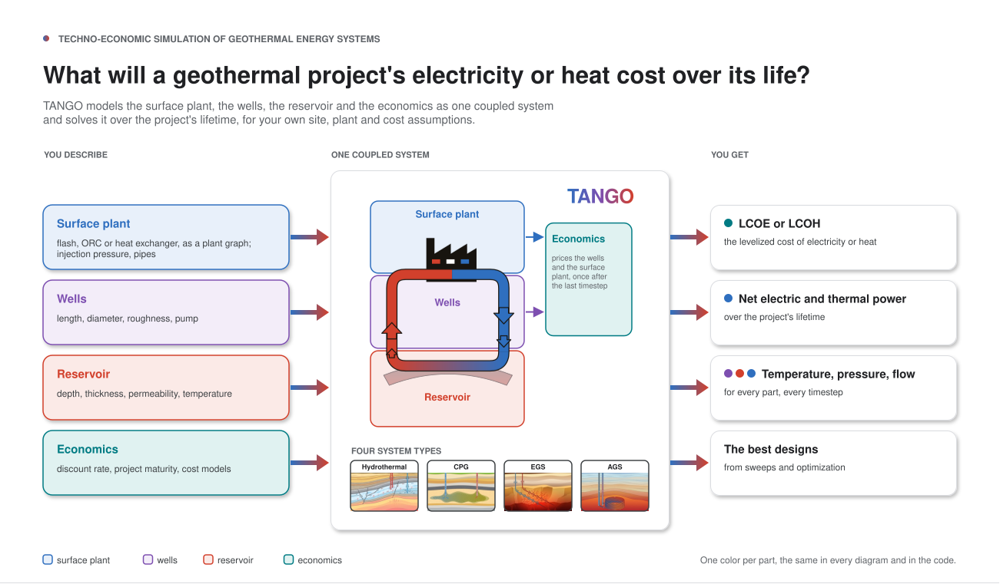
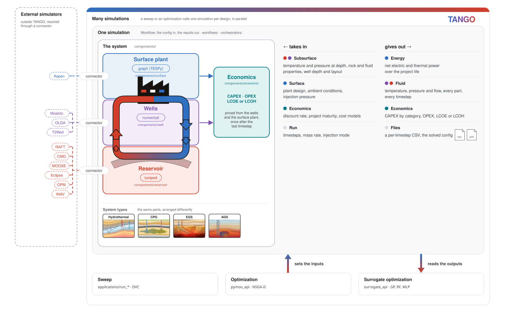
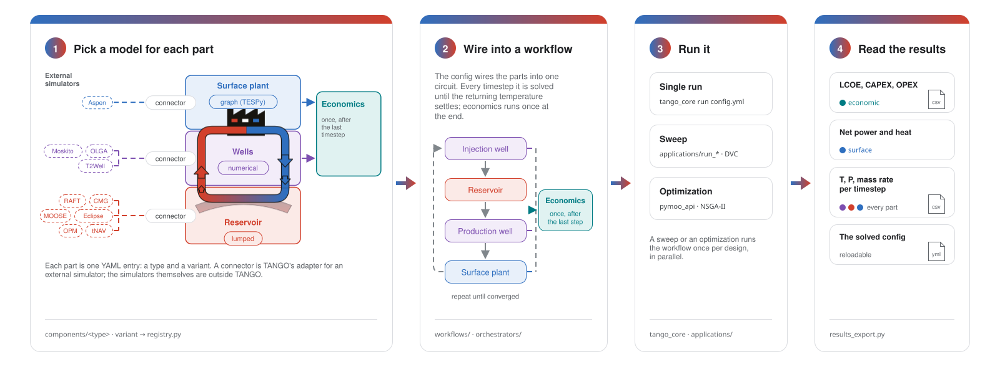
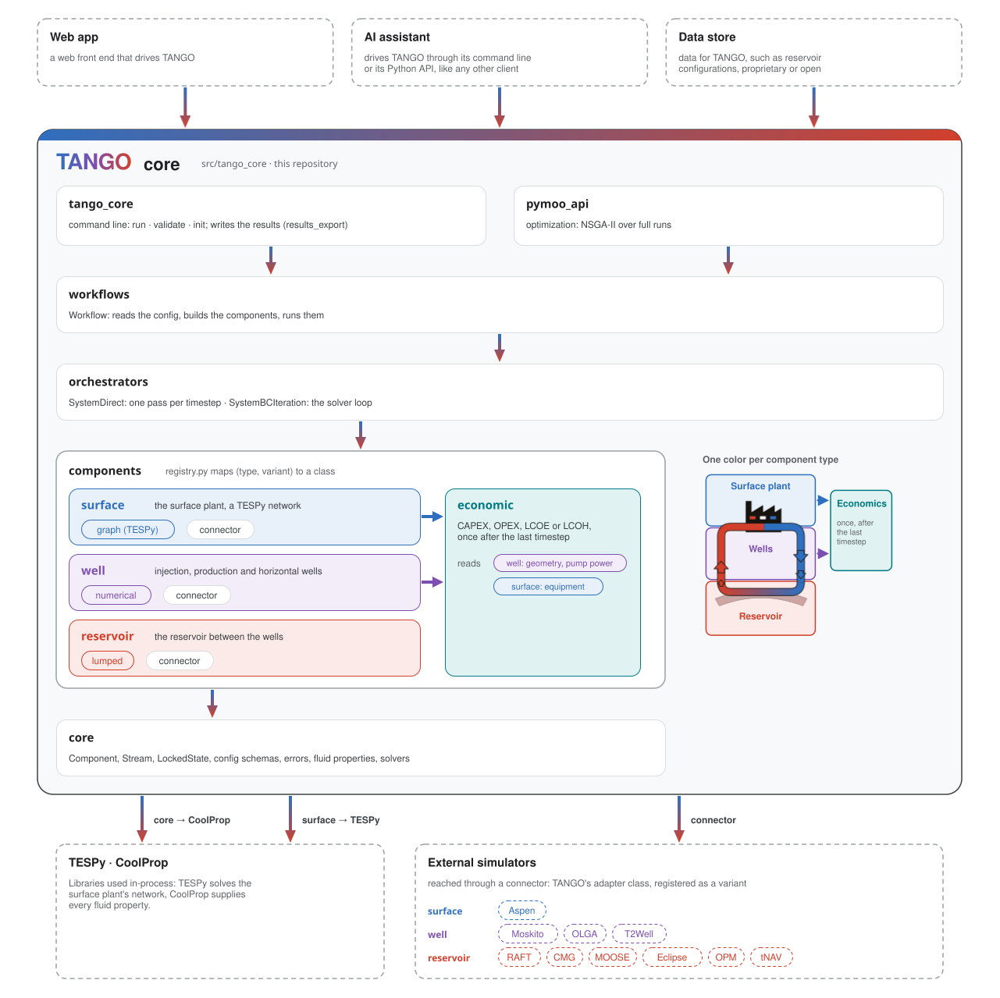

---
hide:
  - navigation
---

# TANGO

**Techno-economic simulation of geothermal energy systems. TANGO couples reservoir, wells and surface plant in one modular simulator, solves them over the project's lifetime and computes the levelized cost of electricity or heat.**

To install and run a first simulation, read [Install](guides/install.md) and [Run a simulation](guides/run.md). Developers start at [Architecture](architecture/index.md), [Runtime](runtime/index.md) and the [API reference](reference/index.md); every term is in the [Glossary](guides/glossary.md).

## What TANGO models

## How you use TANGO

## How the code is organized

