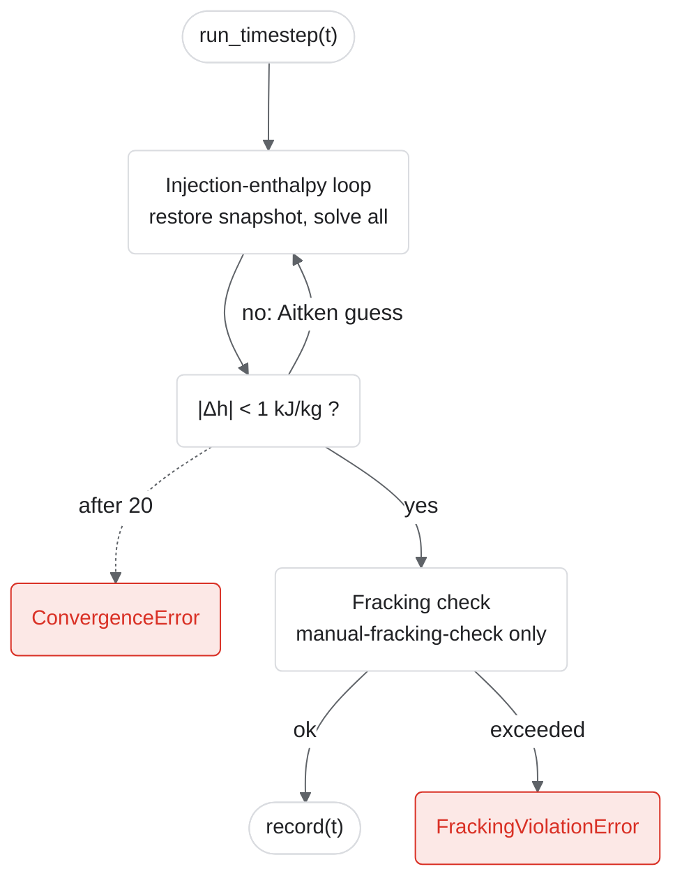

# Boundary-condition iteration

`SystemBCIteration.run_timestep` (`src/tango/orchestrators/system_bc_iteration.py`) decides how one timestep converges. The injection enthalpy is unknown until the surface plant has been solved, so both modes iterate it; `manual-fracking-check` then checks the converged timestep against the fracking limit.

| `injection_mode` | After the loop | Converged when |
|---|---|---|
| `manual` | nothing | \|Δh\| < 1 kJ/kg |
| `manual-fracking-check` | fracking check | \|Δh\| < 1 kJ/kg and no threshold exceeded |

The `auto-pressure`, `auto-flow`, and `auto-both` modes, which adjusted wellhead pressure or mass rate toward the fracking limit, were removed; the `applications/opt_*/` searches find such operating points instead.

Every iteration of the enthalpy loop first restores each component from a snapshot of its `state` (`Component.snapshot_convergence_state`), so each attempt starts from the end of the previous timestep. If a guess drives the fluid below its melting point, CoolProp raises a `Tmelt` error and the loop retries from 275 K.

| Exit | Raised by |
|---|---|
| `ConvergenceError` | 20 enthalpy iterations used up |
| `FrackingViolationError` | `_check_fracking`, in `manual-fracking-check` |
| `ConfigError` | no injection well |

Deep dive: [how injection-enthalpy convergence works](../tango_t_convergence.md).
