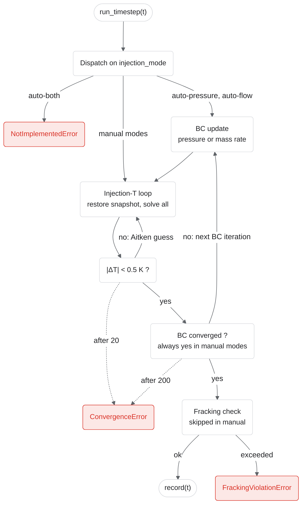

# Boundary-condition iteration

`SystemBCIteration.run_timestep` (`src/tango_core/orchestrators/system_bc_iteration.py`) decides how one timestep converges. The injection temperature is unknown until the surface plant has been solved, so every mode iterates it; the `auto-*` modes add an outer loop on wellhead pressure or mass rate, to stay at the fracking limit.

| `injection_mode` | Outer loop | Converged when |
|---|---|---|
| `manual` | none | \|ΔT\| < 0.5 K |
| `manual-fracking-check` | none, then fracking check | \|ΔT\| < 0.5 K and no threshold exceeded |
| `auto-pressure` | Newton step: `p += target_P − P_inj,out` | relative change < 1e-3 and `P_inj,out < target_P` |
| `auto-flow` | Picard step: `ṁ ← min(fracking_flow(μ, ρ), max_mass_rate)` | relative change < 1e-3 |
| `auto-both` | raises `NotImplementedError` | — |

Every iteration of the temperature loop first restores each component from a snapshot of its `state` (`Component.snapshot_convergence_state`), so each attempt starts from the end of the previous timestep. If a guess drives the fluid below its melting point, CoolProp raises a `Tmelt` error and the loop retries from 275 K.

| Exit | Raised by |
|---|---|
| `ConvergenceError` | 20 temperature or 200 boundary-condition iterations used up |
| `FrackingViolationError` | `_check_fracking`, in every mode except `manual` |
| `ConfigError` | no injection well, in every mode; an `auto-*` mode without a surface or reservoir |

Deep dive: [how injection-enthalpy convergence works](../tango_t_convergence.md).
