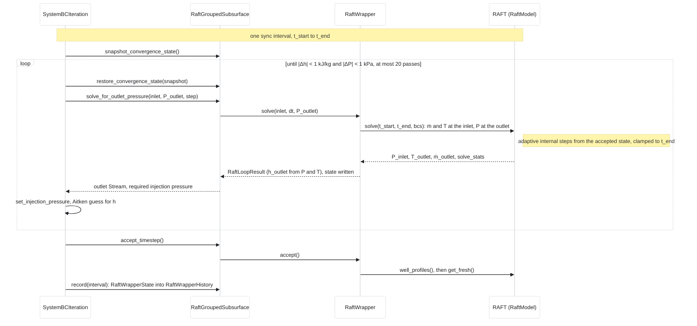

# External-model coupling

How TANGO drives a time-marching model it does not own, with RAFT as the example: which boundary conditions cross the interface each way, how the convergence and time loops reach the model, and how the model's state becomes TANGO state. RAFT simulates an AGS loop's wells and the rock around them; it is the `raft` variant of [`grouped_subsurface`](../components/grouped-subsurface.md), driven by `RaftWrapper` (`src/tango_core/external/raft_wrapper.py`). The physics and the config are on that page; this one is the interface.

## Boundary conditions

| Direction | Values | Where they come from |
|---|---|---|
| TANGO → RAFT | Inlet mass rate and temperature, outlet pressure | The inlet stream (temperature from its enthalpy, with TANGO's fluid properties) and `sim_config.target_extraction_pressure` |
| RAFT → TANGO | Inlet pressure, outlet temperature, outlet mass rate | RAFT's result at `t_end`; the inlet pressure becomes the surface plant's injection pressure |

RAFT's template declares the type of each condition (`function: external` on the inlet's flux and temperature and on the outlet's pressure). TANGO supplies values only, checks the types once at setup, and never switches them. Fixing the flow at the inlet keeps the mass rate under TANGO's control: fluid RAFT loses to the rock would show as a lower outlet flow.

## Convergence: trial and accept

The circuit is closed, so `SystemBCIteration` re-solves each interval until the injection enthalpy and pressure settle (see [Boundary-condition iteration](bc-iteration.md)). Each `RaftWrapper.solve()` is a *trial* that starts from RAFT's last accepted state, so a re-solve needs nothing restored on RAFT's side; the snapshot holds only `RaftWrapperState`. `accept()` commits the last trial once, after the interval converges.

## Time: two clocks

TANGO's sync interval is the coupling step. Inside it, RAFT takes as many internal steps as its own error control needs and ends exactly on `t_end` (RAFT's theory.md, "Adaptive Timestep Control"). Because RAFT commits a step only on `accept()`, the component sets `keeps_external_state = True` and takes one step per sync interval (see [Time stepping](time-stepping.md)).

## State: what RAFT exposes

TANGO never reads RAFT's internals. The wrapper copies what RAFT's coupling API returns into `RaftWrapperState`, one `LockedState` per field, so it is snapshotted, recorded, and exported like any component's state:

| Field group | From | Written |
|---|---|---|
| Inlet and outlet pressure, temperature, and mass rate | `RaftModel.solve()` result | Every pass |
| Internal steps, retries, step cuts, accepted step sizes | `RaftModel.solve_stats` | Every pass |
| Trial solves and wall time for the interval | the wrapper | On `accept()` |
| Pressure, temperature, and enthalpy at each node; mass rate, Reynolds number, and heat transfer coefficient per element | `RaftModel.well_profiles()` | On `accept()`, before `get_fresh()` |

Scalars go to `<stem>.smry.csv` as `<name>.raft_<field>`, where `<name>` is the component's key in the config; lists go to `<stem>.results.yml`. With `--save-dir`, RAFT's own VTKs and logs are kept in `<stem>.raft/` (see [Grouped subsurface](../components/grouped-subsurface.md#outputs-per-timestep)).

## Checks at the interface

TANGO checks what crosses the interface and records RAFT's interior without judging it.

| When | Check | Error |
|---|---|---|
| Setup | Template fluid, rock properties, and initial temperature match `common` (`_check_site`) | `ConfigError` |
| Setup | Well segment lengths match the template's alignment (`_check_alignment`) | `ConfigError` |
| Setup | Inlet group has external flux and temperature, outlet group external pressure (`_check_coupling_groups`) | `ConfigError` |
| Every solve | Outlet mass rate equals the inlet's within 0.1 % (`_check_flow`) | `ConfigError` |
| Every solve | No step accepted at RAFT's minimum timestep above its error tolerance (`_check_dt_min_proceeds`) | `ConvergenceError` |
| Every solve | Outlet is liquid (`_check_liquid`) | `SaturationError` |
| Every solve | RAFT's own `TimestepError` | `ConvergenceError` |

## The pattern

What the RAFT coupling relies on, and what another model needs to be coupled the same way:

1. **A trial/accept API.** `solve(t_start, t_end, bcs)` always starts from the last accepted state; a separate call commits it.
2. **Condition types in the model's own config.** TANGO fills in values and checks the types at setup.
3. **One wrapper module owns every conversion**: units, enthalpy and temperature, and the result format.
4. **Checks only at the interface.** The model's interior is recorded, and its correctness is left to its authors.
5. **The model's state as TANGO state**, one `LockedState` per field, never read straight from the model.
6. **Named errors.** Each model failure becomes a TANGO error carrying the time window and the inputs.
7. **External state declared** with `keeps_external_state`, which limits the component to one step per sync interval.
