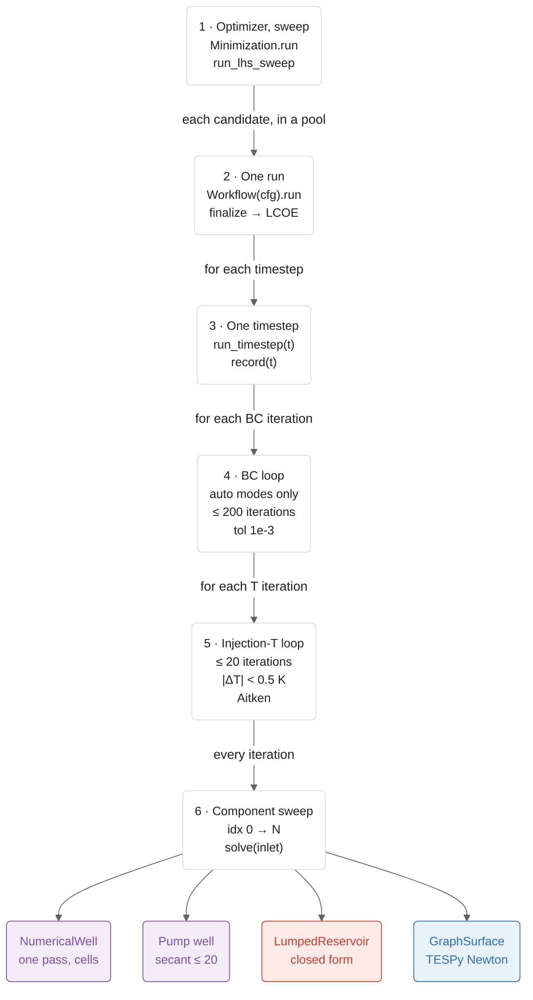

# How a run iterates

One optimization nests six loops. This is the picture to have in mind when a run is slow or fails to converge: the innermost sweep runs once per temperature iteration, per boundary-condition iteration, per timestep, per candidate.

| Level | Loop | Code | Limit |
|---|---|---|---|
| 1 | Optimizer generations or sweep rows | `Minimization.run` (`pymoo_api.py`), `run_lhs_sweep` (`surrogate_api.py`), `applications/*/dvc.yaml` | Set by the app |
| 2 | One full run per candidate, in a process pool | `_Problem._evaluate` → `Workflow(cfg).run()` | — |
| 3 | Timesteps | `SystemDirect.run` | `sim_config.num_tsteps` |
| 4 | Boundary-condition loop, `auto-pressure` and `auto-flow` only | `_converge_injection_pressure`, `_converge_injection_flow` | 200 iterations, relative tolerance 1e-3 |
| 5 | Injection-temperature loop with Aitken relaxation | `_converge_injection_T` | 20 iterations, \|ΔT\| < 0.5 K |
| 6 | Component sweep in `component_idx` order | `component.solve(inlet)` | One pass |

Inside a component, only two solvers iterate: the pump well's secant search on discharge pressure (`secant_solve`, at most 20 steps, each re-marching the well) and TESPy's Newton solve in `GraphSurface`. The numerical well is a single explicit pass over its cells, and the lumped reservoir is closed form.

Details: [the boundary-condition iteration](bc-iteration.md) and [one run end to end](one-run.md).
