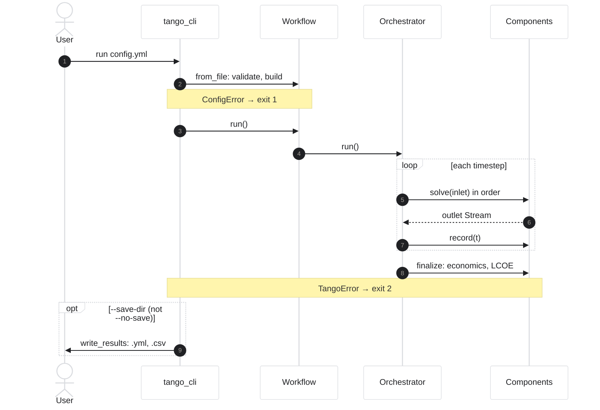

# One run, end to end

What happens between `tango_cli run config.yml` and the results files. The user's two decisions, the config and where the results go (`--save-dir DIR`, or `--no-save` for none; one is required), are the only inputs; the exit code tells a script which stage failed.

| Step | Code |
|---|---|
| Parse arguments, call `_cmd_run` | `src/tango/tango_cli.py` |
| Load and validate, build components and orchestrator | `Workflow.from_file` → `Workflow.__init__` (`src/tango/workflows/workflow.py`) |
| Timestep loop | `SystemDirect.run` (`src/tango/orchestrators/system_direct.py`) |
| Economics, once | `SystemDirect.finalize` → `DoubletEconomicComponent.solve` (`src/tango/components/economic/doublet.py`) |
| Write files | `write_results` (`src/tango/results_export.py`) |

Exit codes and the files `--save-dir` writes are listed in [Run a simulation](../guides/run.md#3-run-it).
