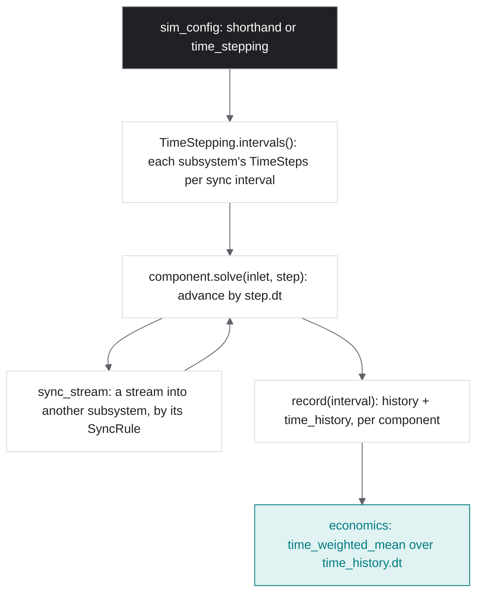

# Time stepping

How a run steps through time: where the steps come from, how subsystems on different grids pass streams to each other, what each component does with a step, and how results over steps of different lengths are combined. All times are in seconds since the start of operation.



## Giving the steps

A config gives its steps one of two ways, never both:

```yaml
sim_config:
  # The shorthand: one fixed grid shared by every component.
  num_tsteps: 25
  dt_years: 1.0

  # ...or a time_stepping block:
  time_stepping:
    subsystems:
      all:
        components: [injection_well, reservoir, production_well, surface]
        grid: {scheme: times, times: [8.64e4, 6.048e5, 2.628e6, 3.1536e7, 7.884e8]}
```

`dt_years` is the one time input not in seconds; it is converted once, when the shorthand becomes a single subsystem, `all`, on one fixed grid. A subsystem names a contiguous run of circuit components that step together on one grid. Every component must be in exactly one subsystem, and every subsystem's grid must end at the same time, which is the project lifetime.

| `scheme` | Fields | Steps |
|---|---|---|
| `fixed` | `step` (s), `num_steps` | `num_steps` even steps of `step`; 20 one-year steps are `{scheme: fixed, step: 3.1536e7, num_steps: 20}` |
| `times` | `times` (s) | One step ending at each listed time, the first starting at 0; strictly increasing, the last one is the end |

With a single subsystem, the `fixed` scheme and the shorthand give the same grid; the shorthand is the shorter way to write it. `fixed` is there for runs with several subsystems, where each subsystem can have fixed steps of its own length, for example 6-month steps for the subsurface and 1-year steps for the surface plant.

Which grid fits depends on the case: an even grid for slow, steady behavior, or a list of times that is fine where things change fast (for example the first weeks of an AGS loop) and coarse afterwards.

## Several subsystems

Subsystems let parts of the circuit take steps of different lengths, for example a closed loop's wells on 6-month steps and the surface plant on 1-year steps:

```yaml
sim_config:
  time_stepping:
    subsystems:
      subsurface:
        components: [injection_well, horizontal_well, production_well]
        grid: {scheme: fixed, step: 1.5768e7, num_steps: 50}    # 6-month steps
      surface:
        components: [surface]
        grid: {scheme: fixed, step: 3.1536e7, num_steps: 25}    # 1-year steps
    sync:                                   # optional; these are the defaults
      subsurface -> surface: period_average
```

The times at which every grid has a step end are the **sync times**, and the span between two of them is a **sync interval** (`TimeStepping.intervals()`). Above, every year is one interval, in which the wells take two steps and the surface plant one. With a single subsystem, every step is its own interval. Grids that share no step end but the last make the whole run one interval.

Each interval is solved in circuit order, one subsystem at a time, each through all its own steps in the interval. A stream passing into another subsystem is collected over the sender's steps, then converted to each of the receiver's steps by the edge's sync rule (`sync_stream`):

| Rule | Each receiving step gets |
|---|---|
| `hold` | The value of the sending step that covers the receiving step's start |
| `period_average` | The average of the sent values over the receiving step, each weighted by its overlap |

An edge without a `sync` entry uses `hold` when the receiver's grid has more steps than the sender's, and `period_average` otherwise. When one sent value covers a receiving step, both rules pass it on unchanged, so two subsystems on the same grid give exactly the run of one subsystem on that grid.

The stream that wraps around the circuit, from the last subsystem back to the first, is solved differently by the two orchestrators:

- `SystemBCIteration` (with `injection_mode`) converges the injection enthalpy once per interval: every pass solves all subsystems through the whole interval, the circuit entry holds one injection stream over its steps, and the loop converges it to the surface plant's outlet enthalpy averaged over the interval. A `sync` rule for the edge into the circuit entry is rejected.
- `SystemDirect` passes the wrapped stream on to the next interval, the same one-pass lag as between two steps of a single subsystem.

Two more rules are checked when the workflow is built:

- A subsystem must be a contiguous run of `component_idx`, so the circuit passes through it once per step.
- A component whose state partly lives in an external simulator (RAFT) can take only one step per interval, because that simulator commits a step only once the interval has converged.

## What a step does

Each `TimeStep` carries `t_start` and `dt`, its length. The orchestrator passes it to every `solve(inlet, step)`. Components with memory across steps advance by `step.dt`: a numerical well's dimensionless time, the lumped reservoir's extracted energy, and RAFT's clock. No component stores a step length of its own.

After an interval is accepted, every component records each of its steps in it: it appends its state to its history and the step to its `time_history`, so entry `i` of every history list belongs to step `i` of `time_history`, also under `save_interval` thinning. A component that took several steps in the interval keeps a copy of its state after each earlier step (`hold_step_record`), since later steps and later passes overwrite `state`; the copies from the accepted pass are recorded in order. Components on different grids therefore have histories of different lengths, each with its own time axis.

## Combining steps

Run averages weight each recorded value by the length of its own step (`time_weighted_mean` in `src/tango_core/core/time_stepping.py`), so a short early step does not count as much as a long late one. This covers net electric and thermal power, the node duties used for plant CAPEX, and downhole pump power (`src/tango_core/components/economic/doublet.py`), and with them LCOE and the opt apps' mean-power objectives. The project lifetime in the discounting is the time at which the grids end: the last `times` entry, `num_steps` steps of `step`, or `num_tsteps` steps of `dt_years`.

The per-step results CSV (`<stem>.smry.csv`) has one row per step end time, `time [s]`; each component's values sit in the rows of its own step ends, and a component with no step ending at a row's time leaves that cell empty. The phase-diagram slider follows the surface plant's steps, and shows each other component at the step that covers the surface step's end time.
