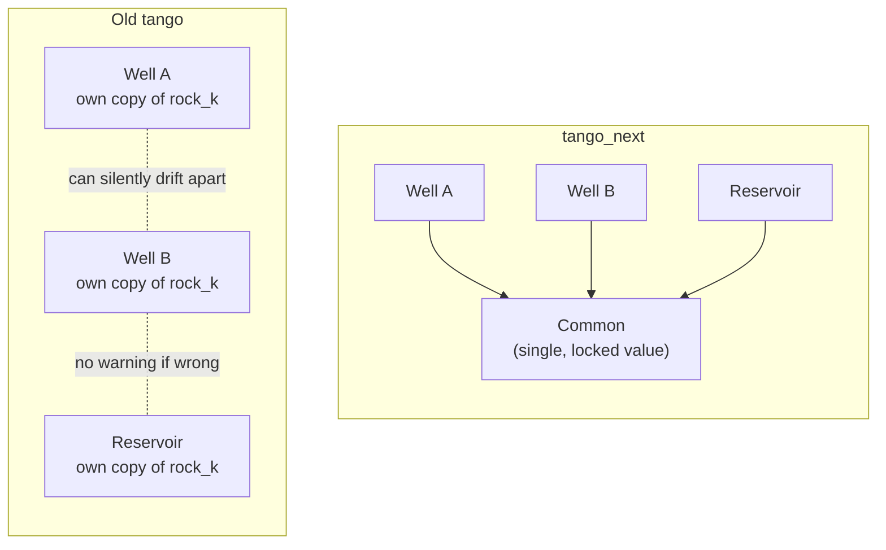

# tango_next: Progress Summary & Forward Plan

*Prepared 2026-07-24. Managerial-level summary — for engineering detail, see
`docs/tango_next_tasks.md` (working task tracker) and
`docs/TANGO_vision_and_roadmap.md` (full technical roadmap).*

## What this covers

`tango_next` is the in-progress rewrite of TANGO's simulation core. The old
implementation (`src/tango/`) remains the validated reference until the
rewrite is proven equivalent; both are maintained side by side during this
transition.

## Accomplished in the past 3 weeks

The throughline this period: `tango_next` isn't just a rewrite of what
already existed — it's structurally more usable, maintainable, and
extensible than the old codebase, and it is being built to modern software
engineering standards from day one rather than retrofitting them later.

**Structural improvements that make the system easier to build on.** Shared
physical parameters (rock properties, surface temperature/pressure) used to
be copied independently into every component that needed them — meaning
one component could silently drift out of sync with the rest of the system
with no warning. `tango_next` now enforces a single shared, locked source
of truth for these values at the data-model level: misconfiguration is
caught immediately at setup, not discovered later as a mysteriously wrong
result. Configuration is similarly locked against accidental modification
once a simulation is built, and computations now cascade cleanly down the
component hierarchy instead of being reassembled piecemeal — both closing
off entire categories of bugs by construction rather than by convention.

**This isn't just theoretical — it already caught a real bug.** Applying
this state-management discipline surfaced a genuine, previously-unknown
inaccuracy in the *old* codebase: it exits its internal convergence loop
using a slightly stale intermediate value rather than the fully-converged
one, quietly under-stating energy extraction every timestep. `tango_next`'s
architecture makes this class of error structurally impossible — proof the
new design isn't just "cleaner," it's measurably more correct.

**Developer onboarding is a first-class concern.** Legacy packaging/build
tooling and dead code were removed, license handling was consolidated, and
CI now runs a real, reliable test subset. A new contributor (or an intern
picking up this work) has meaningfully less accidental complexity to wade
through before becoming productive.

**Modern development practices, applied consistently rather than bolted
on.** Every new `tango_next` module is fully type-checked (`mypy`) and
lint-clean (`ruff`) from its first commit, configuration is validated
through real schemas instead of untyped dictionaries, and every component
supports a clean save/load (serialization) contract — closing gaps the old
codebase never had answers for.

**Validated regression testing infrastructure.** Added "golden snapshot"
regression coverage and automated old-vs-new comparison tests, so that
future changes to `tango_next` are automatically checked against both a
known-good baseline and the legacy implementation. This is what lets
development continue at pace without re-litigating correctness by hand
every time.

**AGS (closed-loop) system support.** Ported the AGS direct-heat use case
end-to-end into `tango_next`, including a working parameter-sweep example
demonstrating the new system can reproduce sweep-style analyses (varying a
design parameter across many runs) that were previously only possible in
the old codebase. This is the first fully modern, closed-loop system type
running in the new architecture.

**Documentation caught up to the code.** The technical roadmap and its
diagrams were reconciled with what's actually built, so the roadmap
reflects real state rather than stale planning.

**Before vs. after, in one picture:**

*Old tango: each component holds its own copy of a shared parameter — nothing stops
them from drifting apart. tango_next: every component reads the same locked value —
divergence is impossible by construction.*

## Where things stand

- `tango_next` can run: flexible single-flash plants (the original
  reference case) and AGS direct-heat systems, both validated against the
  old implementation.
- Still needed before AGS is "done": a power-generation counterpart (needs
  a new turbine/power-plant component that doesn't exist yet in
  `tango_next`), and a small number of edge-case validations.
- Economic modeling (cost/revenue calculations, LCOE/LCOH) has not yet been
  built into `tango_next` — this is a known, scoped gap, not an oversight.
- Optimization tooling (automated design-space search) is planned but not
  started.

## Plan for the next couple of months

1. **Finish AGS parity** — build the missing power-generation component,
   port the electric-generation sweep, and validate both heat and power
   variants against the old codebase.
2. **Broaden system coverage** — fill out the remaining combinations of
   geothermal system type (EGS, CPG, conventional hydrothermal) crossed
   with heat vs. power output, so `tango_next` covers the same range of
   use cases as the legacy system.
3. **Port the wider example library** — roughly 68 previously-validated
   configurations from the old system are queued to be confirmed running
   correctly in `tango_next`.
4. **Design the economics layer** — LCOE/LCOH cost modeling for `tango_next`,
   currently a placeholder.
5. **Build an optimization API** — automated design-space search
   (multi-objective optimization) for `tango_next`, modeled on a proven
   pattern from a sister project, with an explicit design principle that
   the tool will surface tradeoffs to the user rather than silently
   picking a "best" answer on their behalf.
6. **Performance profiling** — once feature coverage stabilizes, profile
   `tango_next` properly and address any real hotspots (deferred
   deliberately — correctness and clarity were prioritized over speed
   during initial development).
7. **Retire the old codebase** — once all configurations are validated
   against `tango_next`, begin removing `src/tango/` and reducing the
   system to a single, modern implementation.

## Bottom line

The past three weeks focused on making the new codebase trustworthy — closing
the specific kinds of silent-failure bugs that made the old system hard to
maintain — and proving that trust with automated regression coverage, not
just on paper. The next phase shifts from foundation-building to breadth:
covering more system types, more examples, and the economic/optimization
features needed for `tango_next` to fully replace the legacy implementation.
