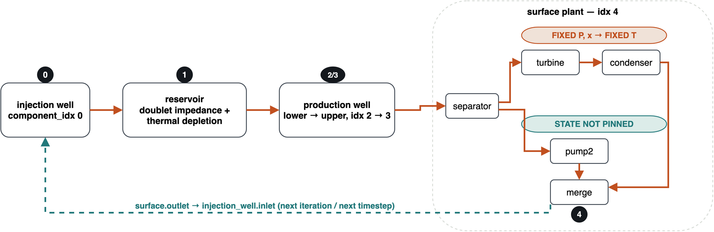
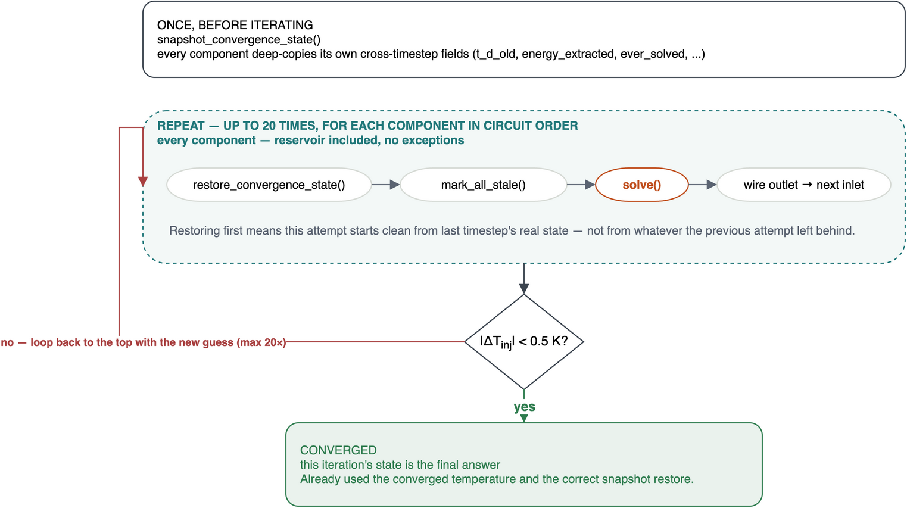

# How injection-temperature convergence works

`tango` &middot; `orchestrators/system_bc_iteration.py`

Reference case: `flexible_SF_manual.yml`, DOUBLET single-flash. The same
mechanism applies to any `SystemBCIteration` circuit.

Every timestep, tango has to find the injection temperature that's
self-consistent with the prescribed injection wellhead pressure and mass
flow rate and everything downstream of it. The temperature must be guessed
initially to enable property calculations of the fluid in the injection
well, but the temperature is fully determined from the other states and
parameters. Because this is an explicit solver, we must solve iteratively
until the returning temperature is stable.

## A. The physical circuit

- **Separator:** the vapor/liquid split fraction is a flash calculation on
  whatever enthalpy actually arrives from the wellhead (at the valve's
  fixed outlet pressure). That fraction sets the mass flow through *both*
  branches — so even the branch with a pinned outlet *state* still carries
  a wellhead-dependent mass *weighting* into the merge.
- **Condenser branch:** its own outlet T/P/enthalpy are pinned boundary
  conditions, genuinely decoupled from the wellhead — but not its mass
  flow (see separator, above).
- **Liquid branch (via pump2):** neither its state nor its mass flow is
  pinned — both are dependent on the reservoir/production-well output.

## B. The convergence loop

Because the reservoir's true output can reach the injection temperature
through the merge above, it has to be re-solved on every attempt like
everything else in the circuit.

- **`snapshot_convergence_state()`** — once, before iterating. Every
  component in the circuit deep-copies its own mutable, cross-timestep
  fields — `t_d_old`, `energy_extracted`, `ever_solved`, and any future
  field of that kind. This is "state as committed at the end of the
  *previous* calendar timestep."
- **For each component, in circuit order** — repeated up to 20 times,
  reservoir included, no exceptions: `restore_convergence_state()` &rarr;
  `mark_all_stale()` &rarr; `solve()` &rarr; wire outlet to next inlet.
  Restoring first means this attempt starts clean from last timestep's
  real state — not from whatever the previous attempt left behind.
- **Check injection temperature** — after one full circuit pass: is
  `|ΔT_inj| < 0.5 K`? If not, loop back to the top with the new guess (up
  to 20 times). If so, converged.
- **This iteration's state is the final answer.** It already used the
  converged temperature and the correct, single-copy snapshot restore.

See `core/component.py` (`snapshot_convergence_state`/
`restore_convergence_state`) and `orchestrators/system_bc_iteration.py`
(`_converge_injection_T`) for the implementation.
