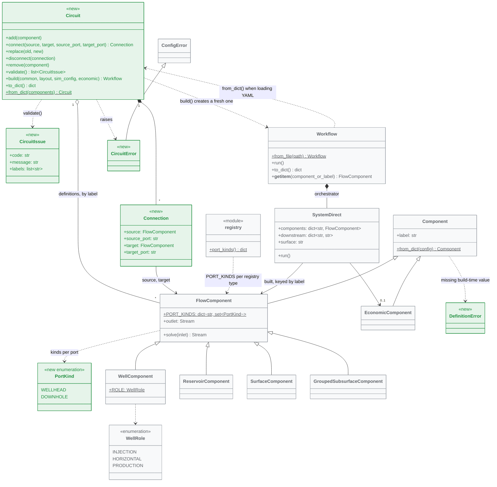

# Design

## Context

See `proposal.md` for the motivation. The current state that shapes the approach:

- `Workflow.__init__` (`workflows/workflow.py`) is the only build path: raw config, then `resolve_linked_quantities`, then pydantic blocks, then `_build_components` through `COMPONENT_REGISTRY`, then an orchestrator. Every sweep and optimizer goes through `Workflow(cfg)`.
- Wiring lives on the components: `Component.component_idx` and `prev`/`next` on the four flow base classes (`well/base.py`, `reservoir/base.py`, `surface/base.py`, `grouped_subsurface.py`). The orchestrators sort by `component_idx`, route outlets by `next`, find the circuit entry at index 0 and the surface at `sim_config.bc_checkpoint_idx`. `prev` is never read. `WellComponent.well_sections()` treats the well at index 0 as the injection well. `phase_diagrams.py` follows `.next` from index 0.
- `type` and `variant` are routing keys: stripped before construction, written back by `Workflow.to_dict()` through `_REVERSE_REGISTRY`. This is the precedent for handling wiring keys without changing the YAML.
- `GraphSurface` already describes its TESPy network as `nodes` and `edges` with `source`/`target` and `source_port`/`target_port`, defaulting to `out1`/`in1`.
- Linked quantities are found by component name (`injection_well`, `production_well_lower`, ...), so component names are part of the config's meaning. In the doublet templates `production_well_lower.wellhead_depth` is derived and left out of the YAML.
- Module layering: `core` <- `components` <- `orchestrators` <- `workflows`. `core` may not import from `workflows`.
- All 19 templates and all regression fixtures are a single ring with consistent `prev`/`next`, the circuit entry at index 0, the surface last and `bc_checkpoint_idx` equal to the surface's index.

## Goals / Non-Goals

**Goals:**

- One build path. A circuit built in Python and a circuit loaded from YAML end up in the same `Workflow(cfg)` construction, so the objects match the config by construction.
- Components hold physics parameters only. Wiring lives in the circuit.
- The graph structure does not assume a ring. Only the "runnable today" checks and the YAML serialization do.
- Shared settings keep their current mechanism (component fields filled by the build), and nothing outside the build fills them, so the follow-up change can turn them into settings bound at build time without touching the circuit.

**Non-Goals:**

- Changing how a timestep is solved. The orchestrators get their order and routing from the circuit, but the solve and iteration logic stays the same.
- A JSON wire format or REST shape for the webapp. `Circuit.to_dict()` and the port-kind data are the interface this change provides.
- Replacing name-based linked quantities with topology-based ones.

## Decisions

### Class overview

The same `FlowComponent` classes appear on both sides of D1: as definitions that `Circuit` holds by label, and as built instances that the orchestrator inside a `Workflow` solves. Only `Circuit.build()` and `Circuit.from_dict()` cross between the two. `SystemDirect` stands for both orchestrators; `SystemBCIteration` subclasses it.

Classes marked `<<new>>` (green where the renderer applies the diagram's styles) are new; the others exist today. Of those, these change: `Workflow` gains `__getitem__` and loads through the circuit; `SystemDirect` gains `downstream` and `surface` (D7); `Component` gains `label` and loses `component_idx`; the four flow base classes lose `prev`/`next` and gain `PORT_KINDS` (D4); `WellComponent` gains `ROLE` (D9); `EconomicComponent` loses its `component_idx` default; `registry` gains `port_kinds()`.



### Usage sketch

How the API reads once implemented; illustrative, not a contract. It rebuilds the circuit of `templates/hydro_sf_electric.yml` (task 8.3). Parameters are the template's; the labels are the template's component names, so the linked quantities (well lengths, `wellhead_depth`, `hydro_static_pressure`, `well_eff_diameter`) are filled by the build as for the YAML. The import path is an open question; the settings are passed as the YAML blocks.

```python
from tango_core import Circuit
from tango_core.components.reservoir.lumped import LumpedReservoir
from tango_core.components.surface.graph import GraphSurface
from tango_core.components.well.numerical import (
    NumericalInjectionWell,
    NumericalProductionWell,
    NumericalProductionWellWithPump,
)

# Definitions: no shared settings, no derived values, no wiring (D2, D8)
inj = NumericalInjectionWell(label="injection_well", diameter=0.4, pipe_roughness=55e-6)
res = LumpedReservoir(
    label="reservoir", reservoir_depth=5000.0, thickness=300.0, permeability=5e-14,
    porosity=0.1, over_pressure_percentage=10, brine_density=1000,
)
lower = NumericalProductionWell(label="production_well_lower", diameter=0.426, pipe_roughness=55e-6)
upper = NumericalProductionWellWithPump(
    label="production_well_upper", well_length=1000.0, diameter=0.426,
    pipe_roughness=55e-6, pump_efficiency=0.55,
)
surface = GraphSurface(
    label="surface", injection_pressure=3_160_000, pipe_diameter=0.201,
    approach_temperature=7.0, pipe_roughness=55e-6,
    power_plant=SINGLE_FLASH,  # the template's nodes/edges block as a dict
)

circuit = Circuit()
circuit.connect(inj, res)        # out1 -> in1 by default (D3)
circuit.connect(res, lower)
circuit.connect(lower, upper)    # lower's outlet kind unknown until the build derives wellhead_depth (D4)
circuit.connect(upper, surface)
circuit.connect(surface, inj)    # closes the ring; surface feeds the entry, so inj gets index 0 (D6)

assert circuit.validate() == []  # list of CircuitIssue, never raises (D5)

wf = circuit.build(
    common={"fluid_name": "H2O", "rock_density": 2650.0, ...},
    layout={"well_spacing": 707.0, "well_pattern": "DOUBLET", "well_pattern_dimens": [1, 1]},
    sim_config={"num_tsteps": 20, "dt_years": 1.0, "injection_mode": "manual-fracking-check", ...},
    economic={"type": "doublet", "discount_rate": 0.095, ...},
)  # bc_checkpoint_idx left out: derived as 4
wf.run()
wf[inj].history       # results live on the built workflow (D1)
wf["surface"].history # by label works too
inj.history           # DefinitionError: set when the circuit is built, read wf[inj]
```

Errors appear where the decision puts them:

```python
circuit.connect(inj, surface)
# CircuitError: injection_well.out1 is {downhole}, surface.in1 is {wellhead} (D4)

circuit.remove(res)
circuit.validate()
# [CircuitIssue(code="open_port", labels=["injection_well"], ...),
#  CircuitIssue(code="open_port", labels=["production_well_lower"], ...),
#  CircuitIssue(code="not_a_ring", ...)]
circuit.build(...)
# CircuitError listing the same issues (D5)
```

An edit is a replacement, and a rebuild leaves earlier results alone (D1, D3):

```python
circuit.replace(inj, inj.model_copy(update={"diameter": 0.5}))
wf2 = circuit.build(...)  # same settings
wf2.run()                 # wf's results are unchanged
circuit.to_dict()         # the components: block of the YAML, wiring keys written from the circuit (D2)
```

The issue codes and message texts are placeholders; task 4.3 fixes them.

### D1. The circuit is a definition; every build creates a fresh workflow

`Circuit` holds definition components and connections. `circuit.build(common=, layout=, sim_config=, economic=)` serializes the circuit and the settings into a config dict and returns `Workflow(cfg)`. `Workflow(cfg)` in turn loads its `components:` block through `Circuit.from_dict`, so both entry points share the same checks and the same construction. The objects a user passes to `connect()` are not the objects that run; results are read with `wf[component]`, which accepts a component or a label.

*Alternative: the connected objects run and hold results.* Rejected: it needs binding, ownership and reset logic on every component, a second build path next to `Workflow(cfg)`, and linked quantities could only be checked, not filled in. A rerun after an edit would overwrite the previous results, which is the wrong behavior for the webapp.

### D2. Wiring leaves the components; the YAML keeps its keys

`component_idx`, `prev` and `next` stop being component fields. In a YAML `components:` block they become routing keys, like `type` and `variant`: `Circuit.from_dict` reads them into connections and strips them before construction, and `Circuit.to_dict` writes them back from the circuit. The YAML key of a component is its `label`. `sim_config.bc_checkpoint_idx` becomes optional: when given it must equal the derived value, and `to_dict` always writes the derived value.

*Alternative: a top-level `connections:` block.* Rejected for now: it changes every config, every fixture and the docs, and needs a macro release. The circuit can emit such a block later without API changes.
*Alternative: keep the fields, set them during build.* Rejected: frozen fields set from outside break definition objects and keep the redundancy the change removes.

### D3. TESPy vocabulary

- Every component has a `label`, unique within a circuit. It is a frozen pydantic field excluded from dumps, because the YAML key carries it.
- `circuit.connect(source, target, source_port="out1", target_port="in1")` returns a `Connection(source, source_port, target, target_port)`.
- A port has at most one connection. A component may declare several ports; every registered component declares one inlet `in1` and one outlet `out1` today.
- `circuit.add(component)` adds a node without connecting it; `connect()` adds both ends if they are not yet in the circuit. A component that `remove()` took out, or one not wired yet, can be held this way.
- A component belongs to at most one circuit. Adding it to a second one raises; reuse goes through `to_dict`/`from_dict` or `model_copy`.
- Editing: `circuit.replace(old, new)` swaps a node and keeps its connections (labels must match), `circuit.disconnect(...)` and `circuit.remove(...)` undo edges and nodes. Components are frozen, so a parameter change is a replacement.

This mirrors `GraphSurface`'s own `nodes`/`edges`, so the outer circuit and the plant inside the surface use the same terms.

### D4. Port kinds by location, as sets of possible kinds

`PortKind` is a `StrEnum` with `WELLHEAD` and `DOWNHOLE`. Each flow component class declares the kinds each port can have as a class constant (not a pydantic field, so not config):

| Class (registry type) | `in1` | `out1` |
|---|---|---|
| Injection wells (`injection_well`) | {wellhead} | {downhole} |
| `LumpedReservoir` (`reservoir`) | {downhole} | {downhole} |
| `NumericalWell` (`horizontal_well`) | {downhole} | {downhole} |
| Production wells (`production_well`, `production_well_with_pump`) | {downhole} | {wellhead, downhole} |
| `GraphSurface` (`surface`) | {wellhead} | {wellhead} |
| Grouped subsurface (`grouped_subsurface`) | {wellhead} | {wellhead} |

An instance narrows a set when its geometry decides it: a numerical production well is `{downhole}` at the outlet when `wellhead_depth > 0` and `{wellhead}` when it is 0, but only once `wellhead_depth` is known (given, or after the build resolved it). `connect()` raises `CircuitError` when the outlet's and inlet's sets do not overlap, so `injection_well -> surface` fails immediately. The build checks the exact kinds on the built components, so a lower production segment that ends below ground cannot feed the surface. `port_kinds()` on the registry returns these sets per registry type, for a frontend to color and restrict handles.

*Alternative: a table of allowed type pairs.* Deferred: it can be added later as an extra check. It lists validated layouts rather than physics and has to be edited for every new component.
*Alternative: derive the lower segment's depth from the connection.* Rejected for this change: it would replace part of `linked_quantities` and widen the change.

### D5. Validation in two tiers, reported as a list

`circuit.validate()` returns a list of `CircuitIssue` (a code, a message, the labels involved) and never raises. Tier 1, structural: ports exist, at most one connection per port, kinds overlap, labels are unique. Tier 2, runnable today: exactly one surface, every component has exactly one inlet and one outlet connected, and the connections form one closed ring. `build()` and `from_dict()` raise one `CircuitError` (a `ConfigError`) listing every issue. Splits and merges are valid in tier 1 and reported in tier 2.

### D6. Derived wiring

The circuit entry is the component connected to the surface's outlet. `component_idx` is the position on the ring walking downstream from the entry, so the entry is 0 and the surface is last. `prev` and `next` follow from the connections, and `bc_checkpoint_idx` is the surface's index. `Circuit.from_dict` builds the connections from `next`, then requires the given `component_idx`, `prev` and `bc_checkpoint_idx` to equal the derived ones. `to_dict()` refuses a circuit that fails tier 2, because one `next` per component cannot express a split.

### D7. Orchestrators receive plain data

Orchestrators may not import `workflows`, so `Workflow` passes them the components as a dict in solve order, a `downstream` map from label to label, and the surface's label in place of `bc_checkpoint_idx`. `_pending_inlets` and the snapshots are keyed by label. The circuit entry is the first component. The solve and iteration logic is unchanged; error context names the label instead of the index.

### D8. Definition components (lenient construction, strict build)

`Component.__init__` validates every value it is given and tolerates a *missing* value only for build-time fields: the shared settings (today's `_PROTECTED_COMPONENT_KEYS`) and the linked quantities. Such an instance is a definition. Reading a field it lacks raises `DefinitionError` naming where the value comes from. `from_dict`, used by the build, stays fully strict. The `__init__` override passes the data through to pydantic, which is the accepted use of `**kwargs` in `.agent/rules/code-quality.md`.

Because `core` cannot import `workflows`, the names of the build-time fields move to one constant in `core` that `workflow.py` and `linked_quantities.py` import, instead of each keeping its own list. When the follow-up change removes the shared settings from components, they drop out of that set by themselves.

`Circuit.to_dict()` dumps each definition with only the fields the user set (`exclude_unset`) plus `type`, `variant` and the wiring, so derived and default values are filled by the build exactly as for a hand-written config.

*Alternatives:* optional fields (`Common | None`), rejected because built objects would carry a type that is never true and about 61 uses would need narrowing; a separate `define()` constructor, kept as the fallback if the spike shows pydantic resists the override.

### D9. Well role from the class

`WellComponent` subclasses declare their role as a class constant: injection wells `INJECTION`, production wells `PRODUCTION`, and `NumericalWell` keeps deciding between `HORIZONTAL` and `PRODUCTION` by `angle_from_vert_deg`. `well_sections()` no longer reads an index.

## Risks / Trade-offs

- [The lenient `__init__` works against pydantic's normal validation] → First task is a spike on one well class; fall back to `define()` (D8) if it needs internals that pydantic does not support.
- [Script users read results from `wf[inj]`, not `inj`] → `inj.history` on a definition raises `DefinitionError` that points to `wf[inj]`.
- [A hand-written config that loaded with inconsistent wiring is now rejected] → No shipped template or fixture is affected; changelog entry under Breaking.
- [Port kinds accept edges that no template has validated, e.g. `injection_well -> production_well`] → Accepted: the kinds describe physics; tier 2 still requires one runnable ring, and an allowed-pairs table can be added later.
- [Labels are load-bearing for linked quantities] → `Circuit.from_dict` uses the YAML keys as labels unchanged; API users who want derivations use the template names, as YAML users do today.
- [Orchestrator keys change from index to label] → Covered by the existing unit tests and the template regression run (`just test --templates`) before merging.

## Migration Plan

No config migration. Existing YAML loads unchanged and `to_dict()` writes the same keys. Release as a meso version with a Breaking entry for configs with inconsistent wiring and a note that `bc_checkpoint_idx` is now optional. Rollback is a revert; no persisted data changes shape.

## Open Questions

- Whether `Connection` gets a label like TESPy's (default `"<source>-><target>"`) or stays unlabelled until fluid results live on connections.
- The public import path (`tango_core.Circuit` or `tango_core.workflows.Circuit`).
- The base class of `DefinitionError`. A `TangoError` matches the other errors, but `hasattr()` and `getattr(obj, name, default)` only treat an `AttributeError` as "missing", so a subclass of `AttributeError` keeps those working on definitions.
