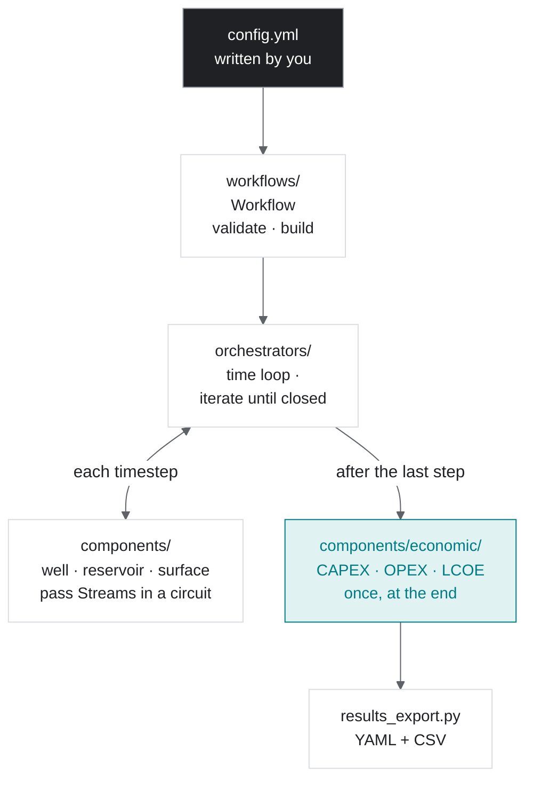

# `tango_core` package

`tango_core` simulates a geothermal project over its lifetime and tells you what its energy costs. You describe the system in one YAML file: which reservoir, which wells, which surface plant, how they connect, and the economic assumptions. `tango_core` turns that file into Python objects, solves them together year by year, and prices the result as a levelized cost of electricity or heat (LCOE/LCOH).

This page explains how the package does that. Read it before opening any module. For more detailed diagrams, see [`docs/architecture/`](https://github.com/GEG-ETHZ/TANGO-core/blob/main/docs/architecture/index.md) and [`docs/runtime/`](https://github.com/GEG-ETHZ/TANGO-core/blob/main/docs/runtime/index.md).

## How a run moves through the package

1. **Load.** `Workflow.from_file` reads the YAML file. Pydantic schemas in `core/specs.py` validate each block. A bad value stops the run here with a `ConfigError` that names the offending field.
2. **Build.** Each entry under `components:` names a `type` and a `variant`. `components/registry.py` maps that pair to a class, for example `("reservoir", "lumped")` → `LumpedReservoir`, and the class is built straight from the YAML. The object holds exactly what the file says ([object == config](https://github.com/GEG-ETHZ/TANGO-core/blob/main/CONTRIBUTING.md#rule-object-is-config)).
3. **Choose how to solve.** When `sim_config.injection_mode` is set, the workflow picks `SystemBCIteration`, which iterates every timestep until the circuit closes. Every shipped example sets it. Without it, the workflow picks `SystemDirect`, which makes one pass per timestep.
4. **Step through time.** For each timestep, the components are solved in circuit order: injection well → reservoir → production well(s) → surface plant → back to the injection well. Each component turns its inlet `Stream` into an outlet `Stream`.
5. **Price it.** After the last timestep, the economics component reads the solved components and their histories once and computes CAPEX, OPEX and LCOE. It never feeds back into the physics.
6. **Save.** `results_export.write_results` writes the config with every solved value (reloadable), a per-timestep CSV and an economics CSV.

## The ideas you need

**Component.** A component is one physical part of the system. Every component subclasses `core/component.py::Component` and implements `solve(inlet) -> None`, which sets `self.outlet`. Wells, the reservoir and the surface plant are components. Economics is a component too, but it has no inlet or outlet.

**Stream.** A `Stream` (`core/stream.py`) carries the three quantities that cross a component boundary: temperature, pressure and mass flow rate, in SI units. Components never call each other. The orchestrator takes one component's outlet and hands it to the next component as its inlet.

**Circuit.** The config wires components by index: each has a `component_idx` and names its `prev` and `next`. The last component's `next` points back to the first, so fluid that leaves the plant re-enters the injection well. The AGS system has no reservoir component and the CPG system has no pump, so the circuit differs from system to system.

**Why it iterates.** The injection well needs the injection enthalpy before it can be solved. That enthalpy only exists once the surface plant downstream has been solved. `SystemBCIteration` therefore guesses it and solves the whole circuit. It compares what comes back with the guess, corrects the guess with Aitken relaxation, and repeats up to 20 times until the difference is below 1 kJ/kg. In `manual-fracking-check` mode it then checks the converged timestep against the fracking limits. Diagram: [BC iteration](https://github.com/GEG-ETHZ/TANGO-core/blob/main/docs/runtime/bc-iteration.md).

**State that cannot be read stale.** Anything that changes from one timestep to the next lives in a `LockedState` (`core/locked_state.py`). It allows one write per solve and raises an error on a read before that write or on a second write in the same solve. This turns "used last iteration's value by mistake" into an immediate error instead of a wrong number. During iteration, each component also snapshots its state at the start of the timestep and restores it before every attempt.

**Economics is one central component.** The wells, reservoir and plant hold no cost logic. `components/economic/doublet.py::DoubletEconomicComponent` reads all of them after the last timestep and prices them by category: wells (one drilling-cost formula per well section), the surface plant (per TESPy node: turbine and generator, injection pump, cooler/condenser), surface pipes, and fixed permitting and exploration costs. It then computes OPEX and LCOE from the run-averaged net power. The reservoir is not costed, and neither is a direct-heat exchanger. Costing each component inside the component itself is not implemented.

**History.** After each timestep, every component appends its state to a matching history (`*History`). Economics and the CSV export read these histories, not just the final value.

## The folders

| Path | What it holds | Read it when |
|---|---|---|
| [`core/`](https://github.com/GEG-ETHZ/TANGO-core/blob/main/src/tango_core/core/README.md) | Building blocks: `Component`, `Stream`, `LockedState`, the config schemas, the error types, fluid properties (CoolProp), the secant and Aitken solvers | You need to know what a component *is* or why a run raised an error |
| [`components/`](https://github.com/GEG-ETHZ/TANGO-core/blob/main/src/tango_core/components/README.md) | The physics and the economics: lumped and numerical wells, the lumped reservoir, the TESPy surface plant, the doublet economics, and the registry | You change a physical model or add one |
| [`orchestrators/`](https://github.com/GEG-ETHZ/TANGO-core/blob/main/src/tango_core/orchestrators/README.md) | The time loop (`SystemDirect`) and the iteration that closes the circuit (`SystemBCIteration`) | A run is slow or does not converge |
| [`workflows/`](https://github.com/GEG-ETHZ/TANGO-core/blob/main/src/tango_core/workflows/README.md) | `Workflow`: YAML in, validated objects and an orchestrator out | You add a config block or call `tango_core` from Python |
| `cli.py` | `tango_core run`, `validate`, `init` | You use the command line |
| `results_export.py` | Writes `<name>.yml`, `.smry.csv`, `.econ.csv` | You need the output files |
| `pymoo_api.py` | Multi-objective optimization (NSGA-II). Each candidate design is one full `Workflow` run, in parallel | You optimize a design |
| `surrogate_api.py` | Samples many runs, trains ML surrogates on them, optimizes on the surrogate, then re-checks the best designs with real runs | Full runs are too slow to optimize directly |
| `utils.py` | `print_datetime` for sweep logs | — |

Each module imports only from modules below it in this order: `core` ← `components` ← `orchestrators` ← `workflows` ← the CLI and the optimization modules. `core` imports from nowhere else in `tango_core`. The one exception is `core/specs.py`, which uses the reservoir's well-pattern helper.

## Where to start reading

1. [`templates/hydro_sf_electric.yml`](https://github.com/GEG-ETHZ/TANGO-core/blob/main/templates/hydro_sf_electric.yml): the flagship config. Its header comment draws the circuit.
2. [`workflows/workflow.py`](https://github.com/GEG-ETHZ/TANGO-core/blob/main/src/tango_core/workflows/workflow.py) `Workflow.__init__`: how that file becomes objects.
3. [`orchestrators/system_direct.py`](https://github.com/GEG-ETHZ/TANGO-core/blob/main/src/tango_core/orchestrators/system_direct.py) `run`: the time loop.
4. [`orchestrators/system_bc_iteration.py`](https://github.com/GEG-ETHZ/TANGO-core/blob/main/src/tango_core/orchestrators/system_bc_iteration.py) `run_timestep` and `_converge_injection_T`: the iteration.
5. One component end to end, for example [`components/reservoir/lumped.py`](https://github.com/GEG-ETHZ/TANGO-core/blob/main/src/tango_core/components/reservoir/lumped.py) `LumpedReservoir.solve`.

## Changing it

1. **A new physical model.** Add a component class and register it. The steps and rules are in [`components/AGENTS.md`](https://github.com/GEG-ETHZ/TANGO-core/blob/main/src/tango_core/components/AGENTS.md).
2. **A new config block or option.** Add a pydantic schema in `core/specs.py` and read it in `Workflow`.
3. **A new injection mode.** Add an `InjectionPolicy` value and handle it in `SystemBCIteration.run_timestep`.
4. **A new outer loop** (sweep, optimizer). Build on `Workflow(cfg).run()`, the way `pymoo_api.py` does. Do not reach into the orchestrator.

The rules for any change are the [TANGO commandments](https://github.com/GEG-ETHZ/TANGO-core/blob/main/CONTRIBUTING.md#tango-commandments).
